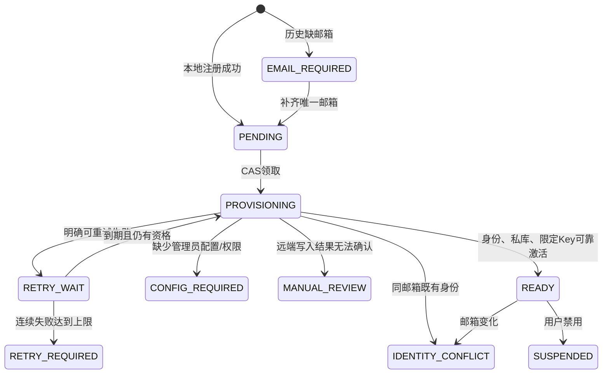

# Design

## Context

见 proposal.md 的动机与两份 capability spec。用户已确认“私有库 + 显式企业共享库”和“本地注册成功，知识待开通重试”。本设计是供审查的实施方案；以下技术取舍由执行方提出，不冒称用户逐项选定。

Octop 已有邮箱归一化/唯一索引，但普通创建、邀请原子兑换、SSO 首次创建不经过同一入口。当前企业插件仅支持一个企业 connection/session，不能把已有单来源测试当成私有+企业联合检索证据。Host setup 是同步注册、已有凭据加密与 generation/CAS 生命周期；没有用户身份枚举或后台工作注册能力。

官方依据固定为 Tencent/WeKnora v0.8.3 commit `3e22822c1d2397be730c458c7539d0eb8c113a24`：

- [管理员用户 API](https://github.com/Tencent/WeKnora/blob/3e22822c1d2397be730c458c7539d0eb8c113a24/website-docs/04-api/02-api-system.md)：创建用户需要 SystemAdmin JWT，platform Key 不支持；新建 201，重复身份 200，冲突 409。
- [用户服务源码](https://github.com/Tencent/WeKnora/blob/3e22822c1d2397be730c458c7539d0eb8c113a24/internal/application/service/user.go)：可提供独立密码；同名同邮箱的 200 不更新密码；个人 tenant 与 Owner membership 由注册模式决定；没有管理员 act-as。
- [租户 API](https://github.com/Tencent/WeKnora/blob/3e22822c1d2397be730c458c7539d0eb8c113a24/website-docs/04-api/02-api-tenant.md)：scoped Key 创建需要该 tenant Owner JWT。
- [知识库 API](https://github.com/Tencent/WeKnora/blob/3e22822c1d2397be730c458c7539d0eb8c113a24/website-docs/04-api/02-api-knowledge.md)：KB 创建独立于用户创建，无受保证的幂等键或名称唯一性。

## Goals / Non-Goals

**Goals:** 在现有企业知识插件中实现可恢复开通与私有来源，保留企业共享来源的显式范围；注册无远端网络等待；所有新页面状态先审规格。

**Non-Goals:** 修改/部署 WeKnora、共享 Octop 密码、远端账号接管、自动重置密码、自动删除远端资源、文档写入界面、新消息队列、任意插件页面平台、在 Dashboard/core 添加供应商业务分支。

## Decisions

### 1. 采用现有插件内异步开通与对账

同步跨系统注册会使本地注册受远端故障影响，与用户选择冲突。新增外部队列/单独开通服务增加部署负担。采用 enterprise-knowledge 内的开通适配与状态机，复用 Host records/credentials。enterprise-policy 只消费窄检索服务，不接触开通凭据。

后台 worker 由 Host 通用生命周期登记、在实际 server 已启动后运行，停用/卸载/关闭时取消并等待已领取工作；不能在同步 setup 里自行遗留 asyncio task。周期对账可信本地身份可修复“用户已提交、通知未发生”的崩溃窗口，注册后通知只作加速，不是可靠性前提。不新增消息队列。

新邮箱策略作为持久的通用用户策略存在，开启后插件临时不可用不应使邮箱必填绕过。注册路径在本地事务内统一执行策略、规范化和唯一性；首次 SSO 缺失可信邮箱时不新建账号，已有绑定登录保持兼容。历史无邮箱账号只限制知识开通，不一刀切阻止登录。

### 2. 核心只提供通用身份和生命周期能力

候选核心模块：infra/users 的统一邮箱策略/创建通知；现有 user repo 的可信分页身份快照；infra/agents/plugins 的受注册权限约束的只读身份能力、提交时身份前提及后台 worker 生命周期；server 负责接线，API 仅通用策略/邮箱错误及现有用户管理。每项在实施 brief 冻结精确路径和接口后方可编码。

身份快照只含稳定 user_id、规范邮箱、disabled 与不透明变化标识，不含密码哈希/SSO token/角色全集；不暴露给浏览器或普通工具。插件提交映射时同时校验当前身份前提及 CAS，网络期间邮箱/禁用变化使激活失败。后台工作使用实际 generation lease，不能伪造 employee actor 或依赖过期管理员角色。

当前 HTTP 用户信息可能来自内存缓存，既有 facade 动作校验不保证重新读数据库角色。增加窄服务端 `reauthorize_actor(actor, permission="authenticated")`，通过现有 Host 持久身份授权 helper、facade executor 与真实 generation lease 复核角色/disabled/Agent-thread 范围，返回新 PluginActor；不更改全部既有 invoke_action 语义，不扩只读身份 DTO。新开通动作只传真实 action/turn 的可信 actor，不从 payload 或后台配置 owner 构造 actor。管理动作入口、提交前及网络发现返回候选前重新复核；确认是独立动作。此检查不承诺角色行锁一直持有到后续 COMMIT。精确合同第九节及任务2.5先独立审查再实施。

所有 WeKnora 字段、HTTP、状态、source resolver、重试调度及业务文案在插件。普通 plugin_records/credentials 的 owner 外键会在用户删除时级联，不能承载删除后仍需保留的写入证明。新增窄 PluginRetainedRecordRepo，复用现有 settings 的内部版本化命名空间及 JSON envelope，提供 plugin/namespace 隔离、revision CAS、只读检查与稳定分页；不新增 schema、不改变普通记录或密钥级联、不公开 raw settings/SQL。保留至应用数据生命周期结束，插件停用/卸载及删除任意用户不清除；本次无 purge/delete/TTL API。

Host 在现有 commit 上增加 retained_writes/retained_checks，默认空，返回仍仅是原顺序的普通 HostRecord。身份前提、两类记录检查/CAS 与凭据激活/删除共用真实事务及 generation lease。仅当存在 retained 输入时，所有普通 writes/activations/credential_deletions 的 owner 都必须被 identity_checks 覆盖，缺失在任何写入前返回 invalid；同一提交不允许非空 requirements，避免隐含实际 owner 的反序锁。纯 retained 不要求用户存在，旧 no-retained 提交（含 requirements）保持原语义。PG 先按已覆盖用户 ID 排序取得身份共享行锁，再依次对 plugin_records、settings 取 SHARE ROW EXCLUSIVE 表锁，以保护不存在键的检查；SQLite 沿用 BEGIN IMMEDIATE。事务内不外呼。坏 envelope 不能解释成缺行，更新比较完整旧原文，不能无条件 upsert。精确通用合同见 user-provisioning-contract.md 第八节；独立增量设计审查通过后才能编码。

### 3. 受控的管理员到个人 Owner 凭据链

管理员在插件加密设置中配置专用 SystemAdmin access JWT；读取只返回是否配置和安全状态，不返回 JWT。JWT 过期/拒绝进入 CONFIG_REQUIRED，由管理员替换。确认 401/403 后按精确管理员 credential ref/revision 持久阻断该凭据的所有用户自动/自助尝试；任务重试或配置仅改显示名不得解除，全新凭据 lineage 才能恢复。现有平台 Key 继续仅用于它已被验证的共享来源能力，不冒充用户创建凭据。

在首个远端用户 POST 前，服务端生成符合远端复杂度策略的独立随机密码及稳定派生 username（不以邮箱裸串作 username），先加密保存短期引导凭据和持久意图。明确 201 后保存 remote user_id、邮箱与 tenant_id，再使用该新用户本人的登录获得 Owner 会话；验证返回身份、home tenant 与实际 Owner membership。部署必须采用 create_personal；tenantless/不完整 membership 明确配置阻塞，不猜测管理员能代行 Owner。

同邮箱 200/409 首次遇到即冲突，不尝试用新密码登录既有身份。未知创建响应先核对；没有已保存 201 身份凭证或管理员明确核对结果时保持 MANUAL_REVIEW，不根据相同 username/email 认领。即使随机密码已预存，也不把“尝试登录已有账号”作为默认归属证明。管理员核对操作只接受服务器发现并展示的候选，记录操作者/原因/预期 revision，不能任意输入 ID 覆盖映射或重置密码。

短期 Owner 引导凭据自首次持久登记起最多可用 24 小时，重试或领取不得延长该截止时间，并在完成后清理。按用户于 2026-10-25 明确选择：到期立即禁止使用；服务运行时执行到期清理，停机则恢复后立即启动清理，过期凭据不得进入任何恢复登录或外呼。停机期间不承诺离线物理到点删除，不增加独立常驻清理机制。网络中断时仅能从未过期的可靠凭据/检查点恢复，过期后转人工恢复。固定源码合同已核对当前 provider 的 KB list、knowledge-search、knowledge detail 和 chunks：最终持久化的 scoped Key 仅含 `capabilities=["retrieve"]` 与严格非空 `knowledge_base_ids=[private_kb_id]`；空白名单在该版本不代表零权限，必须拒绝。不得申请 manage_kbs/ingest/full-access 或将 Owner JWT 用作常规检索凭据。部分文件代理不接受 scoped Key 时保持原文不可用，不扩大权限解决。

### 4. 单一可恢复开通记录和明确的不确定状态

插件按本地 user_id 保存唯一普通 mapping，外呼前将 provisioning intent 存入保留记录；可靠回执与远端 user/tenant/KB 的反向占用也使用保留记录，并与普通 mapping 同一 Host 事务维护，防止另一账号认领。首次配置用 retained 单一 domain anchor 固定 domain UUID 与 canonical base URL；删除配置管理员后重建、改名及密钥轮换均保留该锚点，不能通过第二 URL/配置 ID 绕过历史资源占用。URL 固定不代表物理服务器指纹；同 URL 替换仍保守冲突，部署迁移不在本次范围。占用键包含该不可替换身份域、资源种类与实际 ID（必要时 tenant）。公共状态和内部阶段分开。删除后的非敏感意图通过 fresh-admin 的固定 retained.list 有界摘要可见，不暴露秘密、邮箱或 remote IDs，不恢复已删任务或授予权限。

如果网络期间本地用户删除/变化使正常激活事务失败，有效 generation 可另做 retained-only CAS 保存既有意图对应的可靠非授权回执；不写 READY、不激活凭据、不要求用户仍存在。若崩溃/停用先于保存回执，原保留意图仍是不确定状态，重启先核对，不能盲建。删除后不再自动创建远端资源；凭据级联删除后缺少本人认证则保持人工核对。保留记录的 user_id 仅作关联，不能授予访问权限；另一账号复用邮箱也不能接管已占用资源。

每次尝试最多 90 秒、10 个物理 HTTP、单次最多 30 秒；不隐式重定向或库级自动 retry。明确未产生副作用的暂态故障退避 30 秒起、每次翻倍、上限 10 分钟，连续 8 次后 RETRY_REQUIRED；员工/管理员显式重试以 CAS 重启尝试，不重建意图/可靠资源。后台扫描每 30 秒/wake 最多一页 50 个可信身份、启动一个尝试；持久 cursor 只推进到实际已检查/领取的最后 user_id，领取后不跳到页尾，不因失败退回首项。处理同一用户最多一个租约，测试使用可控时钟。过期领取只能先对账，不能把本地租约过期当远端写入未完成的证明。

KB POST 使用预登记 intent UUID 派生 name/description marker，记录真实 tenant/creator。结果未知时只在正确 Owner 范围核对，唯一匹配可继续；零条不能证明迟到请求不会生效，多条不能挑第一条，均转 MANUAL_REVIEW。Key 的一次性 secret 丢失时，只有可确认为本意图自有的 Key 且 Owner 权限仍有效时才撤销并换发，否则人工核对。不得自动删除用户/tenant/KB。1:1 保证是唯一可靠激活的关联，不虚称上游提供 exactly-once 写入。

最终 retrieve Key 先加密激活至 KEY_STORED 并保存可靠回执，此时尚不授权常规私库请求；重新 resolve 该最终 Key，通过同一实际 private provider 的 LIST+SEARCH 后，才将 READY 映射与引导密钥清理同事务提交，不重复激活已 active 的 Key。验证失败保留恢复检查点，不重建库/Key。完整 proof/CAS 与预算生命周期在 user-provisioning-contract.md 第十节冻结。

私有库创建成功不等于有内容：映射及最小可读权限就绪后允许空库；模型/向量配置不满足创建或检索时明确失败，不能创建假文档来制造就绪。

### 5. 私有与企业来源分开认证，联合检索

继续沿用已有企业凭据代理与 Octop 五层授权，不自动给个人账号加入企业 tenant。企业来源由企业凭据+真实 tenant 和显式本地 employee grant 共同限定；私有来源使用该员工自己 KB scoped Key。只通过个人 Key 无法访问企业库，企业 Key 也不能被当作个人身份。

新增服务端来源快照，包含不透明 source_id、kind、真实 connection/mapping revision 与库集合；页面提交 source_id+KB 选择，服务端重建权限。不同 tenant 的相同 KB ID 必须保持不同选择，不将 raw KB ID 当全局资源键。默认选择在真实线程上初始化一次；主动 [] 保持为空，未就绪不回填为其他来源。

同一操作在首次模型前依次检索选中来源，共享原有预算；按稳定的来源/上游顺序合并去重，去重键含来源身份而非 KB ID。全部来源验证成功后原子发布最多 8 条证据及各来源 revision；任一失败不进入最终模型。知识工具只复用该批已授权证据，不重查或换来源。并行检索的复杂性暂不引入，保持可验证的预算与终态。

证据内部保存 source_id、真实映射/连接及 tenant 的不可替换关联，renderer 仅展示服务端证据接口返回的安全来源分类与名称。续读、历史、撤权与最终模型前的检查同时覆盖所有已选来源。旧单企业来源操作保留原解释，不能把它解析成新私有来源。具体 DTO 增量、包/服务版本和兼容转换在来源任务的 brief 中与现有未发布 0.1.0 契约一起冻结并审查。

### 6. 页面使用现有入口和插件容器

| 入口 | 用户与动作 | 边界 |
|---|---|---|
| 现有邀请注册 | 新用户填写必填邮箱，注册后看到账号成功/知识待开通 | 不新增公开 signup；页面只使用通用注册策略 |
| 现有用户管理 | 管理员登记邮箱、看通用校验错误 | 核心不展示 WeKnora 身份/凭据业务表单 |
| 插件 settings | 管理员配置 JWT、查看各用户开通状态、核对冲突、恢复任务 | action 服务端 fresh admin 与 revision 校验；无明文回显 |
| 插件 composer | 员工看自己状态、重试、选择私有/企业库 | 待开通显示内联状态并保留草稿，不伪装为空库 |
| 现有证据侧栏 | 展示已鉴权来源、阅读与续读 | 不信模型标签；不展示 tenant 配置/Key |

布局沿用已审 enterprise-knowledge-plugin-ui 的 settings/composer/证据侧栏，在同一选择列表内增加“我的私有库”“企业共享库”分组；待开通为选择区上方状态行，不新增弹窗导航。管理员任务区采用“员工邮箱｜状态｜最近尝试｜可用操作”表格，配置 Key/JWT 输入提交后清空。加载、无权限、无库、错误、冲突、确认中、成功及迟到响应均显式处理；键盘焦点和 aria-live 状态、中英 locale、服务器时区随原容器。

## Risks / Trade-offs

- [管理员 JWT 期限较短] → 配置阻塞状态+替换后从检查点恢复；不持久保存管理员登录密码。
- [上游非幂等写入] → 未知结果进入核对，牺牲完全自动恢复；不向员工承诺任何网络故障都自动处理。
- [后台周期与生命周期] → 可靠性依赖可重放对账而非进程内通知；generation 失效与用户变化必须覆盖迟到提交。
- [联合来源扩大既有契约] → 私库状态、联合来源选库与相关检索/证据 UI 先完成对应 producer/权限合同审查；已有冻结共享管理动作的连接/显式授权/专家共享绑定表单可先实施，不猜新增 API，不以此宣称私库可用。
- [SSO/历史账号兼容] → 只对新建执行必填，历史补齐流程与不同 subject 邮箱冲突有专门测试，不静默合并。

## Migration Plan

通用宿主和使用已冻结动作的共享连接/员工显式授权/专家共享绑定设置可先独立交付。私库相关顺序仍为：通用邮箱策略、Host 身份/生命周期与保留记录基础（本地代码且不默认启用）→企业插件开通服务/Mock 合同→私有与共享来源生产者→私库状态/联合选库及相关证据页面→真实部署验收。用户已授权继续既有第一阶段；新的页面实现须先通过本增量设计/spec 审查。

配置前清点既有邮箱重复、缺失与远端同邮箱冲突，管理员显式开启策略和开通配置后逐用户对账，不自动改写历史邮箱或远端账号。回退时停 worker、阻止新知识操作并保留映射/意图及已建远端资源；不删除用户数据、不降低数据库水位。正式联调在管理员配置后使用专用测试身份，记录真实版本和权限证据；本设计/合成测试不表示已经创建任何远端账号。

## Open Questions

仅剩部署输入：专用管理员 JWT、实际 auth.default_tenant_mode、个人 tenant 模型/向量/存储可用性及专用测试邮箱/资源。缺失项使开通保持配置阻塞，不改变上述本地规格、实现顺序或安全恢复策略。

### Producer 执行细分

3.1 依次由 I03a1 严格公开 DTO、a2 配置与保留摘要动作、a3 状态/意图/反向占用/CAS 领取交付；仅 a1 完成不勾选整个3.1/1.2。a1 的精确模型/字段与两路径白名单见 user-provisioning-contract.md 第十节和 task-I03a1-models-brief.md；两份通用前置2.4/2.5先验收。candidate/private provider/HTTP/worker 在各自精确 brief 审查后实施，不用占位实现注册动作。

本地配置子批的精确合同为 prd/evidence/enterprise-p1/provisioning-config-contract.md（I03a2，独立规划待审）。仅 config.get/config.save/retained.list 三个真实管理动作；员工状态/重试与管理员任务动作等 a3 实际状态记录后注册。独立 preparation UUID 保留未知 staged 引用，实际 config/anchor/prep CAS 与激活/替换/旧active删除/COMMITTED 同事务，不以暂存超时或 resolve-notfound 推断清理完毕。相同当前 JWT 不换 ref、不清拒绝 lineage；保留 reader 只做固定 header 的有界安全投影。该局部合同不承诺全历史 JWT 内容回用识别或跨进程 staged 全部清理，不增加核心 API/GC/队列，不代表3.1完成。

### I03b1 provisioning wire adapter refinement

The independently reviewed `prd/evidence/enterprise-p1/provisioning-wire-contract.md` freezes a two-path internal HTTP adapter slice before worker integration: fixed seven v0.8.3 endpoints, stage-exclusive client credentials, strict success projections, caller-owned completion and no-effect/unknown outcomes, shared existing90/30/10 budget and managed cleanup. The adapter has no Host persistence and trusted pre-send callback is not proof of an implemented durable intent. Existing resources are not adopted; user-create200 cannot become a login. This refinement does not complete task3.2 until actual producer/provider integration and required acceptance hold.
