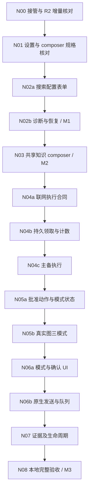

# Octop 下一阶段开发计划与实施明细 v1.0

日期：2026-10-26。基线：`codex/enterprise-p1` / `6dcdb8961b233e1bf91f9219882b66179dedb247`。

状态：**规划稿，供后续执行；未启动本计划功能编码。** 本文细化已有第一阶段需求，不宣布发布、不提前勾选 OpenSpec。实施结果以原 OpenSpec tasks 与执行证据记录为准。

## 1. 阶段目标与取舍

下一阶段交付员工可实际操作的“配置搜索 → 选库提问 → 确认公开查询 → 查看可信证据”闭环。优先让已完成的后端能力出现在插件页面，再补受控联网执行，不继续单独累积后台模块。

沿用用户已确认的约束：插件化开发；页面先制定/核对 OpenSpec；SearXNG 主源、Firecrawl 备源；默认 KB_ONLY；WeKnora 远端验证转人工；功能/测试实现优先交 GPT-6 Luna subagent。

| 推进方式 | 收益与代价 | 本文安排 |
|---|---|---|
| 先完成全部后端，再集中写 UI | 后端顺序简单，但用户继续看不到可操作结果 | 不采用 |
| 按可操作闭环分批，先设置 UI，再知识 composer，再联网 | 复用现码，每个里程碑可实测；需要预先冻结跨层合同 | **推荐，作为本计划执行顺序** |
| 先补私库生产者与真实远端开通 | 推进身份闭环，但受远端人工输入影响，并延后搜索和聊天页面 | 放到下一阶段之后 |

以上顺序是本次规划建议，不写作用户已单独批准的新产品决策。既有产品规则不变。

### 1.1 本阶段范围

- 搜索设置页面：配置、保存、分别诊断、冲突处理、安全恢复、状态提示。
- 共享知识 composer：选择已授权库、默认值、主动清空、准备 operation、原生发送接线。
- 受控联网：持久领取/去重、主备请求预算、精确公开词批准、三模式服务端执行。
- 现有证据组件的 WEB 适配及本阶段历史/取消/停用/重启所必需的闭环。
- 本地真实安装与 Windows 浏览器验收、阶段全量质量门槛。

### 1.2 后续独立推进

自动私库开通生产者、远端 wire、后台对账/退避/24h 清理、私有与共享联合检索及页面，保留原私库任务；本阶段不假装它们已完成。完整 legacy 迁移、T0/升级回退、正式双 ZIP 发布及完整 Alpha.1 门禁另行收尾。

用户明确要求的个人私库和企业共享库并存仍是产品需求。当前 composer 只开放已实现的共享来源，不能显示虚假的“私库已就绪”。

## 2. 接管基线与事实源

| 项 | 当前事实 |
|---|---|
| 唯一功能开发目录 | `C:\Users\Administrator\.codex\worktrees\enterprise-p1\octop` |
| 主仓导航目录 | `E:\git\octop`，当前 main；不能在此重做功能或清理未跟踪目录 |
| 整项计数 | 主计划 15/29；插件 UI 5/13；私库 6/18。三组有包含关系，不能合并计算总完成率 |
| 搜索现码 | `search_http.py`、`search_settings.py`、`search_settings_actions.py` 已存在；`search.get/save/test/recover` 已注册 |
| 最近定向验证 | 基线搜索两文件测试已实际复跑：136 passed，exit 0 |
| 全量记录边界 | 5674 passed / 236 skipped 的 make all 属于旧基线 `74dc70d8`；不能套用到新 HEAD |
| 聊天实际限制 | SessionService / OperationService 当前限制 KB_ONLY；DTO 声明三模式不代表执行链支持三模式 |
| UI 实际入口 | `ui/src/index.ts` 目前注册 settings 和 evidence renderer，尚无业务 composer 注册 |

按顺序读取：

1. `AGENTS.md` 与 `prd/evidence/enterprise-p1/execution-status.md` 最新段。
2. `openspec/changes/enterprise-knowledge-p1/{design.md,tasks.md,specs/}`。
3. `openspec/changes/enterprise-knowledge-plugin-ui/{design.md,tasks.md,specs/}`。
4. `prd/evidence/enterprise-p1/search-settings-contract.md`、`search-http-adapters-contract.md`。
5. `prd/evidence/enterprise-p1/{core-delta,plugin-host-v1,runtime-boundary,tool-dock-ui-contract,evidence-reader-ui-contract}.md`。
6. 原实施计划与 `enterprise-user-private-knowledge` 规格，核对兼容及后续范围。

`Octop_Cursor_Handoff_2026-10-26.md` 的主体描述 `74dc70d8` 历史交接，不再把其中“搜索 settings 未实现”“P10b1 NOT READY”作为当前事实。

## 3. 开发边界

| 归属 | 本阶段允许内容 | 约束 |
|---|---|---|
| `plugins/enterprise-knowledge/enterprise_knowledge/` | search、session、operation、approval、evidence 业务实现 | Host 存储/CAS/凭据；包内相对导入；不访问核心私有 repo |
| `plugins/enterprise-knowledge/ui/src/` | SearchSettings、Composer、批准弹窗及现有证据增量 | 通过 Host action 请求；不直接 fetch、不持久化密钥 |
| `plugins/enterprise-policy/enterprise_policy/` | 既有 middleware 的三模式服务调用与绕过阻断 | 只通过版本化服务调用 knowledge；不跨插件导入私有模块 |
| `dashboard/src/plugins/toolRenderers/` 等已有通用桥接 | 仅修复被本阶段场景证明的通用接线缺口 | 先更新 core-delta；不加入供应商名、模式算法或企业表单 |
| `src/octop/infra/agents/plugins/` | 原 Host 能力原则上直接复用 | 新增 API 必须先证明现有能力不够并单独冻结合同；不预设改核心 |

不新增业务路由平台、导航菜单或服务；不直接编辑 `src/octop/dashboard/`；不修改 `.venv` 或 SDK。优先复用现有迁移 v22 与 Host 记录，不为业务状态预建新核心表。

## 4. 依赖与里程碑



| 里程碑 | 必须可演示的成果 | 允许计入的任务 |
|---|---|---|
| M1 管理员可操作搜索设置 | 真实安装包中保存配置、分别诊断、显示冲突和恢复；没有权限的用户不见管理表单 | 主 5.3 / UI 2.4 的已满足部分；整项条件全部满足才勾选 |
| M2 员工可操作知识问答 | 正常登录、选库、主动清空、发送、证据/续读；本地上游可用明确标注的 HTTP mock | UI 3.1 的已满足部分，不推导私库完成 |
| M3 本地三模式闭环 | 精确确认后联网，主备受控，WEB_ONLY 无知识请求，HYBRID 内部先行，取消/停用不迟到写入 | 主 5.2/5.4、UI 3.2 等按全部原条件核对 |

M1 不依赖主备编排；管理员单源诊断不要求员工 query approval。M2 保持仅 KB_ONLY，不用临时假按钮开放三模式。完整 UI 4.3 和主 7.4 含更多场景，不能因三个里程碑完成而直接勾满。

## 5. 实施明细

下面文件均为相对开发 worktree 路径。标注“新建”是计划产物，尚不存在；输入输出以先行冻结的合同为准。每批一个 writer，通常不超过 5 个直接实现/测试文件，双语键等配套改动另列入该批 diff。

### N00 接管与 R2 增量核对

**依赖：** 无。**性质：** 只读核对优先；无缺陷不改代码。

- 核对实际 HEAD、安装副本版本、工作区、136 项定向测试与新提交 diff；不重审全部已接受 Host。
- 对 R2 检查当前数据库角色复核、CAS、凭据恢复和诊断返回脱敏；发现真实缺陷列精确修复子批，不增加无关功能。
- 已知接入问题需先解决：authenticated search.get 当前对员工也投影源地址/版本，未满足“员工仅 readiness 摘要”；CA 省略会清除旧值。二者先列入 N01 合同与 N02a-1 后端增量，不能只隐藏前端输入。
- 记录 `prd/evidence/enterprise-p1/next-stage-baseline.md`（新建），注明哪些是本次运行、哪些只是历史报告。

**验收：** 精确基线已记录；R2 可用或具体缺陷已关闭；没有把旧全量报告迁移到新 HEAD。**验证：** 搜索两文件定向 pytest、实际增量的 Ruff/format/mypy；不为接管重复跑全仓。

### N01 设置与知识 composer 合同核对

**依赖：** N00。**涉及：** 现有 UI settings/chat specs、UI design、`search-settings-contract.md`、`tool-dock-ui-contract.md`。

- 按现有 DTO 对齐 `SearchSettingsOutput` / `SearchSaveInput` / `SearchTestInput` / `SearchRecoverInput`，明确固定角色、凭据操作、观察 revision、权限与错误状态。
- 冻结员工 search.get 的字段白名单与返回 schema：只给所需 readiness 摘要，不返回管理员地址、版本、CA/凭据状态或诊断详情；如需独立员工 DTO，同步动作输出 schema 和消费者类型。
- 区分配置可用、最近诊断结果、员工实际授权三种状态。现码 `web_search_ready` 由配置投影得到，不等于真实连通成功；不得由前端替代服务端授权。
- 冻结 CA 的保留/替换/清除语义：现码 get 只返回 ca_bundle_configured，但 save 省略 ca_bundle 时写入 None，直接接表单会丢失旧 CA。推荐新增显式 CA 操作、默认 KEEP，仅 REPLACE 提交可信字符串、CLEAR 显式清除；字段兼容与管理员权限先审，不通过回显已有 CA 规避问题。
- 冻结 composer 使用实际 Host `registerComposerPreparation` 的类型子集、注册/卸载、context generation 与本地 `operation.prepare`。插件本地 `host.ts` 类型缺项时只补与宿主相同的声明，不发明运行时接口。

**验收：** 页面调用都有真实已定义 action；缺失的状态和文案归属已补充；规格未出现未实现私库数据或默认放权。**验证：** 对照实际 Python/TS 类型逐字段核对，必要修订后执行 OpenSpec validate；保留评审记录。规格已有内容不另建重复 change。

### N02a 搜索配置表单

**依赖：** N01。**先行子批 N02a-1：** 按 N01 冻结合同，在 `search_settings.py` / `search_settings_actions.py` / `test_enterprise_search_settings.py` 实现 CA 操作与员工投影增量并同步合同；真实 Host 测试证明编辑地址不丢 CA、显式清除生效、CAS 冲突不修改旧值，并从真实 action 入口断言员工响应字段白名单。此项是已确认的页面接入前提，不把 R2 当不可修改的完整成品。

**UI 子批 N02a-2 预计改动：** 新建 `ui/src/SearchSettings.tsx`、`SearchSettings.test.tsx`、`searchApi.ts`；修改 `ui/src/Settings.tsx` 和插件 UI 双语资源。

- 复用现有 settings surface；管理员看到固定主/备角色、地址、版本、可信 CA 输入和 Firecrawl write-only 凭据，SearXNG 不提供密钥输入。
- 使用 `search.get/save`；提交 expected_revision 和 KEEP/REPLACE/CLEAR；保存成功清空敏感输入，冲突保留安全编辑并允许重载。
- 普通员工不请求管理员数据、不显示管理表单；只使用已授权的 readiness 摘要。

**验收：** 两源真实 action 可保存；无浏览器持久密钥/明文回显；权限、加载、错误和冲突状态可用。**验证：** 新组件测试 + 插件 UI typecheck/test/build；已有 Settings 测试不回退。

### N02b 单源诊断与恢复，完成 M1

**依赖：** N02a。**预计改动：** 上批 SearchSettings/searchApi 及测试；必要时只对已确认的 R2 缺陷另立 Python 子批。

- 每次只诊断所选源，显示明确的公开测试词确认、时间、observed_revision、耗时、结果数和错误；诊断不 fallback、不产生聊天证据。
- recovery_blocked 时阻止保存/诊断，提供 admin 恢复动作；无法证明清理成功继续展示阻塞，不用 UI 本地清旗标。
- 晚到诊断不能覆盖新配置；一源缺失不显示联网可用；焦点、en/zh、服务器时区完整。

**验收：** 保存→分别测试→修改配置→丢弃旧结果可实测；恢复失败仍阻塞；无 chat context 也能合法诊断。**验证：** 组件并发/权限测试、真实安装插件后的浏览器管理流程，保存脱敏截图与请求记录。

### N03 共享知识 composer，完成 M2

**依赖：** N01、M1。**预计改动：** 新建 `ui/src/Composer.tsx`、`Composer.test.tsx`、`composerApi.ts`；修改 `ui/src/index.ts` / `host.ts`；配套资源分小批落地。

- 注册并清理 composer surface，复用现有会话/目录 action；第一次选库只在 selection_present=false 时通过 revision-zero 保存授权默认，保存空数组不回填。
- 只开放 KB_ONLY；使用真实原生 thread 后调用本地 operation.prepare，payload 不携带 question、actor、自造 scope 或 operation_id。
- context generation 过滤迟到结果；准备失败保留草稿，准备期间新输入不被旧快照清除；先复用已有 Host 发送机制。

**验收：** 选库→问答→现有证据阅读可走通；清空阻止知识发送；跨用户/专家/线程、两页初始化冲突不串状态。**验证：** Composer 组件测试、现有 session/operation 定向测试、真实 Host + HTTP mock 的知识发送流程。若 Host 缺口被复现，单列通用修复，不在核心写企业分支。

### N04a 冻结联网 operation、批准与证据合同

**依赖：** M2。**预计产物：** `prd/evidence/enterprise-p1/search-operation-contract.md`（新建）；对应主 change design/controlled-search spec 的必要修订。

- 明确搜索配置 revision 加入 session/operation/approval 的方式、旧 KB_ONLY 记录兼容、web readiness 和当前员工/专家权限来源；WEB_ONLY 不依赖知识连通或调用知识 probe。
- 冻结一次批准消费与首次外发领取的原子关系、同 operation 并发结果复用、未知发送结果/重启/取消终态、持久请求计数和两个截止时间起点。明确业务返回 deadline 与 TLS/parser/client drain 的所有权：不得把无界 aclose 等待串入备用前而重置/越过 22 秒；迟到清理由可追踪生命周期收尾，不能创建无归属后台任务。
- HYBRID 遵循原计划 P12：内部先终结，EMPTY/失败不自动生成或追加 query；已有显式 HYBRID 与有效公开词批准才可按合同继续外发。保留成功来源并标记部分失败，两边都失败停止有据回答；当前用户/operation 授权被拒绝不得用部分成功掩盖。冻结 EMPTY/FAILED/DENIED 的完整分支表、内外证据总投影与排序、WEB evidence 的 locator/原文打开方式。
- 核对公开词存储生命周期：原 PRD 写“仅当前操作内存”，现有 approval helper 会把 public_query 写入记录，不能直接当作最终联网存储合同。推荐持久化领取/计数/消费状态和关联摘要，原词只在本次操作内存保留、重启失效；精确匹配/并发复用与清理方案须在本批冻结，不把完整词放日志或验收报告。

**验收：** 合同逐项写出状态转移、输入输出、闭集错误和请求数；测试矩阵无“由模型决定”项；未决项不能标 READY。**验证：** 与既有 operations/models/evidence/policy 实现和两个原合同逐项兼容核对，OpenSpec 修订后验证通过。

N04b 及之后的新字段、内部类/方法或 action DTO 在 N04a 冻结前都是候选设计，不能由不同 writer 各自猜测实现。

### N04b 持久领取、批准消费和请求计数

**依赖：** N04a 合同 READY。**预计改动：** `enterprise_knowledge/operations.py`、`models.py`；新建 `search_operations.py`、`tests/unit/plugins/test_enterprise_search_operations.py`；旧 operation 测试。

- 使用 Host CAS 保存 search execution 记录、来源/批准快照和 attempt 计数；领取者独占发起资格，其他调用观察同一结果/失败，不能另开一轮。
- 在首次外发前原子消费对应批准并预留请求次数；状态未知不能清零重试。备用仅使用同次消费的公开词，不要求再次确认。
- 取消/中断/配置变化后拒绝新预留和迟到提交；重启不复活旧批准，重试要求新 operation 和批准。

**验收：** 并发/重复调用最多两次总发送；批准最多消费一次；提交未知或重启不能重复请求。**验证：** 真实 Host + SQLite 的并发/CAS/崩溃点测试，包含重新构建 service 实例；跨进程语义不能用进程内锁冒充。

### N04c 主备搜索执行

**依赖：** N04b。**预计改动：** 新建 `enterprise_knowledge/search.py`、`tests/unit/plugins/test_enterprise_search.py`；复用 `search_http.py`，必要最小兼容增量另列。

- SearXNG 为主、Firecrawl 为备；单源 10 秒、整个联网 operation 22 秒，解析/授权等待不重置预算。
- 仅 timeout/429/5xx 允许备用一次；401/403、EMPTY、协议错误、权限失效和取消不切备；无 adapter 自动 retry。
- 两次实际发送前分别通过 pre_send 复核当前身份、批准/operation 绑定、配置和生命周期；上游响应不能绕过提交时复核。

**验收：** 错误切换表、10/22 秒、总计两次以及取消行为均有精确请求计数证明。**验证：** MockTransport + 可控时钟/调度，增加 Event 卡住 TLS/parser 的超时与清理归属测试，证明不阻塞业务 deadline、不迟到发布；不依赖真实 22 秒 sleep；保留既有搜索回归，新修复后按实际测试数记录，不固定为 136。

### N05a 会话模式与用户批准动作

**依赖：** N04c。**预计改动：** `sessions.py`、`operations.py`、`models.py`、`actions.py` 的合同增量及 `tests/unit/enterprise/test_sessions.py` / `test_operations.py`，按单一所有者拆两批。

- 开通 WEB_ONLY/HYBRID 的真实能力检查，保持 KB_ONLY 默认；失去能力不静默改模式，返回可解释阻塞。
- 注册 N04a 冻结的用户批准/撤销动作（如 `query.approve`，最终以合同为准）；只接受确认词与服务端 operation 关联，不允许客户端指定可信身份/授权范围。
- public_query 原样保存，前后空白/换行/Unicode 变化均使旧批准失效；绑定当前用户、thread、专家、operation 与相关 revisions。

**验收：** 无批准拒绝联网；跨上下文、改词/范围/模式/配置的旧批准不可消费；WEB_ONLY 不因空知识库阻塞。**验证：** session/operation/action 定向矩阵；动作通过真实注册入口调用，不只直接测内部方法。

### N05b 实际 SDK 图三模式接线

**依赖：** N05a。**先行子批 N05b-1：** `evidence.py` / `service.py` 与对应测试实现最小 WEB producer、evidence.list 来源再授权和内部/外部证据分组 DTO。WEB 证据不得强套知识 connection/scope 校验；混合证据按来源分别授权，WEB_ONLY 列证据仍零 WeKnora。UUID、实际 provider/degraded、搜索 revision 与 operation 绑定齐备后，才可接模型成功链。不能等 N07 才补这个前置。

**图接线子批 N05b-2：** `service.py`、`tools.py`、`enterprise-policy/enterprise_policy/policy.py`；现有 integration query/policy/tools 测试按服务与图分片落地。

- KB_ONLY 零 web；WEB_ONLY 零 WeKnora（包括 probe/catalog）；HYBRID 先完成内部检索，再按已冻结语义决定批准外发。
- 模型工具重复调用只读取同一 operation 的结果；只有可信服务端 evidence 可进入结果，不通过模型指令控制回退或计数。
- 沿用 Ask/Plan/Craft 独立控制与已接受实际工具身份准入；现有 legacy search/MCP/browser/exec/delegation 绕过仍被拒绝。

**验收：** 真实 Manager + 两插件 + 已安装 SDK 默认图证明三模式顺序和零调用；整轮拒绝/失败时不调用最终模型，HYBRID 单源失败依合同使用已授权成功证据并明确标注部分结果。**验证：** MockTransport 记录事件顺序和计数，使用确定性模型，不改 SDK、不伪造 ToolMessage。

### N06a 模式选择与精确确认 UI

**依赖：** N05b，先对照已冻结 chat UI spec。**预计改动：** Composer 与测试；新建 `PublicQueryDialog.tsx` / 对应测试；双语资源。

- 插件三模式控件独立于 Ask/Plan/Craft；不可用项显示服务端原因，保留当前选择并阻止发送，不自动降级。
- 用户主动填写/确认公开词，原样显示和提交，不从内部片段、历史、附件或模型补词；取消不调用批准/搜索。
- 模态初始焦点 Cancel，Tab 焦点约束、Escape 取消、关闭后返回触发点；待提交期间点击和快捷键都防重复。

**验收：** 确认/取消、空白字符、改词失效、键盘/读屏、权限变化可测。**验证：** 真正表单交互组件测试 + UI typecheck/test/build。

### N06b 原生发送、队列与编辑联调

**依赖：** N06a。**预计改动：** Composer 准备逻辑/测试；Host 现有 composerPreparation 与原生发送测试按风险补充，核心代码仅在证明通用缺口后改动。

- 每次发送按固定文本/附件快照保存自己的 operation/approval/context；双击不创建第二份消费，队列不读取当前 UI 的新上下文代替旧项。
- 编辑重发准备新 operation/批准；HITL 继续原后端上下文；忙时追加作为独立下一轮，不偷变为 steer。
- 首条消息先解析真实 thread；任一步失败保留原草稿/队列项，过期批准要求再次确认。

**验收：** 首发、忙时追加、队列恢复、切线程、编辑与 HITL 都有实际发送接线证据。**验证：** 复用宿主已有测试，对新增边界补用例；不能只调用模拟的 prepare callback 代替完整路径。

### N07 可信证据与本阶段生命周期

**依赖：** N06b。**预计改动：** 在 N05b 最小证据能力上扩展 history/reading/service 与测试、现有 EvidenceRenderer 与测试，按历史后端、前端展示、生命周期三个串行子批实施。

- WEB/KNOWLEDGE 证据带真实 UUIDv4、operation 及来源；URL/原文按冻结合同处理，网页正文只作不可信资料，不执行其中指令。
- 复用卡片/侧栏；历史重开走 evidence.list 再授权；无页码/无原文如实展示。跨用户 UUID、撤权、来源变化、伪引用不得获得内容。
- 本阶段已开放的联网 operation 必须完成取消/重启/禁用收尾：旧批准失效、旧 facade 不提交、迟到结果不新增证据/答案、停用不再开始备用。

**验收：** 正常引用/历史、恶意文档、撤权及 cancel/restart/disable 场景都可验证。**验证：** 现有 reading/evidence/renderer 测试 + 实际 Host 生命周期集成。完整 P13 若尚有其他未覆盖分支，仍保留主 6.1 未勾选。

### N08 集成验收，完成 M3

**依赖：** N07。**产物：** `prd/evidence/enterprise-p1/next-stage-acceptance.md`（新建）、截图与脱敏请求/预算记录、实际质量日志及 OpenSpec 场景映射。

- 核对实际安装的两个插件、UI bundle/manifest/版本；独立测试 home，正常认证，不依赖旧 session 或仅源码构建成功。
- Windows 浏览器走 M1/M2/M3：管理配置→选库→知识提问→证据续读→精确批准→WEB_ONLY/HYBRID→取消/停用→可解释恢复。上游 mock 必须显式标注，真实 Host/权限/插件不能 mock 掉。
- 执行全量门槛和插件独立检查；真实供应商/WeKnora 缺输入保持人工待验，不把 mock 截图写作远端 PASS。

**验收：** 所有本阶段必需场景有非零断言、命令退出码和可复查证据；失败修复完成；整项勾选遵守原任务全部条件。**验证：** 下节命令，范围外缺证据仍单列，不能宣称 Alpha.1 发布完成。

## 6. 验证方法与执行规则

### 6.1 本机已存在的命令

```powershell
$env:PYTHONUTF8 = '1'
# 现有搜索回归
uv run pytest tests/unit/plugins/test_enterprise_search_http.py tests/unit/plugins/test_enterprise_search_settings.py -q
# 现有业务与集成路径；执行时按本批影响选择具体文件
uv run pytest tests/unit/enterprise -q
uv run pytest tests/integration/test_enterprise_plugin_actions.py tests/integration/test_enterprise_plugin_policy.py tests/integration/test_enterprise_plugin_query.py -q
# 插件 UI：首次缺依赖时才执行 npm --prefix dashboard ci
npm --prefix plugins/enterprise-knowledge/ui run typecheck
npm --prefix plugins/enterprise-knowledge/ui run test
npm --prefix plugins/enterprise-knowledge/ui run build
# 本机阶段结束门槛：使用实际 Git Bash 路径
$env:PATH = 'D:/Git/usr/bin;D:/Git/bin;' + $env:PATH
make 'SHELL=D:/Git/bin/bash.exe' all PYTEST_JOBS=4
npm --prefix dashboard exec -- tsc -b
npm --prefix dashboard run lint
npm --prefix dashboard run test
make 'SHELL=D:/Git/bin/bash.exe' build-frontend
```

新测试文件在对应批创建后才加入命令，本文不冒充它们已存在。插件 Python 的 Ruff/format/strict mypy 按实际变更路径单独运行；`make all` 的核心源码扫描不代表覆盖插件代码。插件 UI 当前没有 lint script，不能把不存在的 `npm run lint` 当门槛；按实际工具配置检查其格式/静态规则。

全量记录必须核对实际 collected/executed 数，避免 testmon 增量 0 项被当作完整套件通过。只有启用增量筛选时才注明筛选方式；需要全量时显式关闭筛选。`make all` 包含格式写入，运行前后核对 diff，拒绝混入其他会话修改。

### 6.2 每批交付格式

1. 读取本批 brief：基线、允许/禁止路径、合同输入输出、失败语义和具体测试。
2. 功能/测试 writer 按既定偏好使用 GPT-6 Luna；共享文件只有一个 writer，不让多个子代理同时写 models/actions/operations/Composer。
3. 用能证明用户行为的测试实现；修复授权、并发或预算风险时保留针对性失败复现，不为每个小组件创建重复测试层。
4. 提交给独立审查者一次检查规格和增量质量，附作者命令/退出码；只追具体问题，不反复无范围全仓审查。
5. 核对实际 diff、定向验证和里程碑证据后更新 execution-status；没有完整条件不勾选原大任务。

本阶段不自动提交、推送、部署或发布。若后续接手工具没有指定模型/子代理能力，必须如实说明实际执行者，不编造模型记录。

### 6.3 进度与防止再次长期停留的规则

- 以 M1/M2/M3 的可操作成果为主进度，原 OpenSpec 整项计数同时保留；用“代码已写/本地已验/实机已验/人工待验”区分，不混成“完成”。
- 每批完成写一条准确记录；发现合同缺口停止该依赖链，转入不依赖它的已授权工作，不循环重写已接受模块。
- 单批超过一个聚焦实现会话，或实现/测试文件超过约 5 个时，先拆批；不承诺未经基准支持的小时/天数。
- 关键评审只针对共享接口、授权、并发、请求预算、真实图和 UI 接线；已绿无风险变化的用例不反复运行。全仓在里程碑交付前按门槛运行。

## 7. 风险与开工时必须冻结的决定

| 风险/缺口 | 所属批次 | 处理与停止条件 |
|---|---|---|
| R2 定向测试不能证明全部安全恢复分支 | N00 | 限定新提交复核；真实问题独立修复，不能用 UI 遮盖 |
| 配置 ready 与诊断成功混淆 | N01/N02 | 明确字段语义与显示；不在前端自动授予员工联网权限 |
| 设置页无法保留现有 CA | N01/N02a-1 | 先冻结并实现 CA 操作合同，再接表单；不把字段省略当清除 |
| 员工 search.get 返回管理元数据 | N00/N01/N02a-1 | 先改服务端字段投影和 schema；真实 action 负例验证，不能只藏表单 |
| operation/approval 还没有 search revision 绑定 | N04a/N05a | 冻结版本兼容与原子前提后改 DTO，禁止只在 UI 存版本 |
| 领取后崩溃/发送结果未知导致重复外呼 | N04a/N04b | 持久预留、终态与新批准规则；无法证明时不得重放 |
| HYBRID 分支、证据总量及公开词保留期缺完整执行合同 | N04a | 落实原 P12 部分结果语义；原词内存与持久消费状态分离，冻结完整分支表 |
| UI 测的是新源码、服务跑的是旧插件副本 | M1/M2/N08 | 记录安装版本/摘要，正常认证后走真实 surface |
| WeKnora / 搜索实机缺地址、资料或权限 | 人工对接 | 本地 mock 能继续；远端保持待验，不循环阻塞本地开发 |
| 多会话同时改分支 | 每批 | 开始/结束核对 HEAD 与 diff；有外部改动先重建本批基线，不覆盖 |

## 8. 与剩余第一阶段任务的关系

| 现有任务 | 本阶段贡献 | 仍需后续/人工 |
|---|---|---|
| 主 5.1 | 保留 adapter 与本地合同证明 | 两个真实供应商版本/部署/响应证据 |
| 主 5.2 / 5.4 | N04～N07 实现完整本地受控编排、批准和模式 | 依原验收标准核对，不能凭页面演示推导全部通过 |
| 主 5.3 / UI 2.4 | N01～N02 设置闭环 | 真实供应商诊断结果单列 |
| 主 4.2 / UI 3.1～3.4 | composer、真实引用、历史/队列接线 | 私库来源增量与完整 Windows 场景仍按对应任务 |
| 主 3.5 / 6.1 | N07 补本阶段证据及生命周期 | 全部恶意文档/history/生命周期场景必须分别核对 |
| 私库 3.x～5.x | 只保持兼容，不计功能完成 | 后续 R6/R7：生产者→来源合同→联合检索→私库页面 |
| 主 6.2/6.3/7.x | N08 贡献质量与安装证据 | legacy/T0/回退、正式包、PG、远端、20题及发布 Gate |

推荐开工顺序：**N00 → N01 → N02a**。第一个交付点是可操作的搜索设置页面，不等待完整主备编排或私库远端对接。

## 9. 本次规划审查记录

已完成一次独立只读 builder 审查，并对照源码补入四项前提：CA 保留/替换/清除、员工 search.get 最小字段投影、WEB 证据后端前移、deadline 与 drain 所有权。它们分别纳入 N01/N02a-1、N05b-1、N04a/N04c，**尚未修改功能代码**。

后续合同冻结和真实测试仍按各批执行。本次文档核对不能替代这些批次的功能/安全验收，也不改变原任务完成数。
