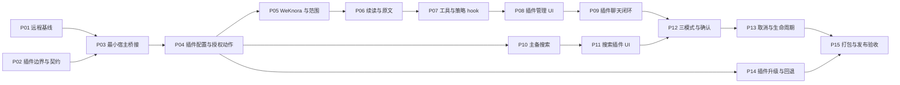

# Octop 企业智能体工作台第一阶段 Implementation Plan

> **For agentic workers:** 用户已要求先细化再执行，并将功能代码分派给 GPT-6 Luna subagent；按 OpenSpec apply 与 `superpowers:subagent-driven-development` 执行、独立审查并记录台账。不自动提交或推送。业务功能必须以 Octop 插件交付，宿主改动受第 2 节白名单约束。步骤以复选框跟踪。

**Goal:** 通过可独立安装、启停、升级和回退的 Octop 插件，交付远程 WeKnora 企业知识闭环和受控主备搜索，满足 PRD 的 A-01～A-07。

**Architecture:** 本机开发 Octop，WeKnora 已部署在其他服务器。企业知识、授权规则、证据、搜索适配和业务 UI 放入工具插件；执行策略放入配套 hook 插件。Octop 核心只提供可信身份、权限与线程校验、命名空间存储、凭据、插件操作分发、生命周期和有限 UI 挂载桥接。继续使用现有 Harness、插件安装机制与聊天 shell。

**Tech Stack:** Python 3.12+、现有 octop-harness/LangGraph 插件 SDK、Pydantic、httpx.AsyncClient、Octop SQLite/PostgreSQL、React 18、TypeScript、Vite、pytest、Vitest；包管理沿用 uv/npm。

**Spec:** [产品定义与第一阶段 PRD](./Octop_产品定义与第一阶段二开实施计划_v1.0.md)；[AGENTS.md](../AGENTS.md)；[Octop 插件约定](../plugins/README_CN.md)。

**文档状态:** 2026-10-24；按插件化方向进入执行。详见 [执行细则](./evidence/enterprise-p1/execution-details.md) 和 [执行状态](./evidence/enterprise-p1/execution-status.md)。本文件替换此前把企业业务直接放入 `src/octop/infra/enterprise/` 的实施方案；原 PRD 保持 REVIEW。任务按实际实现/验证逐项登记，未完成项保持 PLANNED，远程验收尚未完成。

**2026-10-25 用户范围增量：** 新账号以唯一规范邮箱 1:1 对应 WeKnora 用户与私有库，同时保留显式授权的企业库；本地注册成功后异步开通，失败保持待开通并重试。增量执行以 [范围决策](./evidence/enterprise-p1/identity-provisioning-decisions.md)、[用户与私库 OpenSpec](../openspec/changes/enterprise-user-private-knowledge/tasks.md) 和 [精确合同](./evidence/enterprise-p1/user-provisioning-contract.md) 为准，优先于本计划早先对“账号/KB 开通写入”的非目标；文档上传/删除及远端部署仍不在授权范围。邮箱策略已本地验收，可信身份/后台工作/开通生产者及来源页面按依赖继续实施；不把该增量的进度混入原 P01～P15 完成计数。

## 1. PRD 分析与已核查的插件能力

| 核查项 | 当前事实 | 推进结论 |
|---|---|---|
| 开发拓扑 | 用户确认本机仅用于 Octop 二开，WeKnora 在其他服务器。 | 不安排本机部署 WeKnora；从专家执行主机验证远程地址、证书和 REST 接口。 |
| 源码基线 | HEAD=`dd9dce470844c25d59effb50615bb3c667ea25cd`；当前 main，origin=`git@github.com:loudon84/octop.git`；本地引用未见 develop。 | 实施前读取远程分支与实际部署信息；不静默以 main 代替 develop。 |
| WeKnora 旧 adapter | 已有列库、搜索、阅读；范围参数可覆盖默认值，空范围回退可见库；片段每块截断 1,200 字符。 | 可参照 REST 映射，不能直接作为企业授权路径；保留其原有非企业用途。 |
| 既有插件注册 | PluginContext 提供 ctx.tool、ctx.middleware、ctx.skills；PluginManifest.kind 只能为 tool/skill/hook/channel 之一。 | 工具和 middleware 分成两个配套插件；不能虚构一个 kind 同时调用两类注册方法。 |
| 既有加载机制 | plugins/README_CN.md、PluginManager 与 harness loader 支持目录/ZIP 安装、setup(ctx)、全局启停和 Agent 配置；加载器支持包内相对导入。 | Python 业务模块放插件包内，沿用相对导入；不修改 .venv 或重写加载器。 |
| 插件启用语义 | harness/plugins/tools.py：全局启用后，未显式关闭的 Agent 默认可用工具。 | 不假定“全局启用等于逐专家授权”；每次工具调用仍校验企业开关、绑定、员工和会话。 |
| 既有 UI | octop_ui envelope、registerRenderer、host.request、patchResult、openSidePanel 已存在。 | 引用和阅读复用工具卡片/侧栏；patchResult 仅改变显示，不能授予权限或写可信证据。 |
| 当前 SDK 缺口 | PluginContext 没有业务 API 路由、DB/Secret 服务注册；UI Host 没有管理表单/composer 挂载接口。 | 不能承诺零核心改动。只补有限宿主桥接，并明确标记拟新增接口；不扩建通用页面插件平台。 |
| 身份缺口 | internal_mcp 使用连接级 token；gateway/langchain 的工具闭包持有凭据，不证明本轮员工身份。 | 企业调用必须使用宿主逐轮提供的身份和操作引用；旧工具可达入口由策略 hook 拦截。 |
| 原生知识库 | infra/knowledge、Chat knowledge_base_ids 和原生引用属于另一条链路。 | 不把 WeKnora ID 写入原生字段，不要求本地 embedding 模型，不同步远程索引。 |
| DB/验证基线 | 当前迁移和断言已到 v21；AGENTS.md 的 v20 说明落后。此前既有连接器/搜索探测单测 89 passed。 | 迁移以源码及应用水位决定编号；89 passed 不作为企业功能或实机验收证据。 |

以下新增宿主 API 均为本计划提案，不声称上游已经具备。

## 2. 开发边界：插件业务与最小宿主桥接

### 2.1 必须遵守的规则

| 规则 | 开发边界 | 可验证要求 |
|---|---|---|
| PLG-01 业务归插件 | WeKnora/搜索 HTTP、五层授权算法、DTO、连续阅读、证据、三模式、主备错误规则、迁移映射位于插件。 | 新企业业务逻辑不得放入 src/octop/infra/enterprise、api/routers/enterprise_knowledge 或宿主 Chat 页面。 |
| PLG-02 核心仅桥接 | 核心只管理插件能力、可信 actor、线程/专家可访问性、命名空间记录、密文引用、分发和生命周期。 | 核心不认识 allowed_kb_ids、WeKnora URL、public_query、10/22/30/90 秒业务值，不按企业 plugin_id 写专属分支。 |
| PLG-03 UI 归插件 | 连接/授权/专家绑定、搜索设置、选库/模式/确认、引用/阅读均由插件 UI 实现。 | Dashboard 只增加固定宿主挂载点和通用上下文透传，不直接 import 企业 UI 源码。 |
| PLG-04 挂载范围有限 | 仅补 settings 和 composer 两类固定 surface；结果展示使用已有 renderer/侧栏。 | 不允许插件注册任意页面、导航、路由或覆盖整个 Dashboard；不新增页面级插件平台。 |
| PLG-05 能力经宿主 | 插件通过 Host API v1 使用身份、记录、凭据、遗留连接只读导入和线程权限。 | 插件不得直接 import Octop repos、私有 manager/server 全局对象，不读写 Octop 主库文件或凭据文件。 |
| PLG-06 生命周期受控 | 工具插件、策略 hook、UI 与宿主契约版本配套；企业功能默认关闭。 | 缺策略插件、版本不匹配、加载失败、禁用或卸载时，已有企业 Agent/会话拒绝新调用，不能变成普通会话继续执行。 |
| PLG-07 扩展可替换 | 插件源码、UI、包、版本、数据命名空间独立；不修改 Harness/第三方安装目录。 | 替换插件 ZIP 不需要重编宿主；只有宿主契约升级才需要发布 Octop。 |
| PLG-08 停用保留数据 | 停用/卸载不删除原生数据、远程资料或插件持久记录；清理由显式管理操作完成。 | 停用、升级失败和回退可演练，用户数据摘要不变。 |
| PLG-09 权限仍在后端 | 前端 surface、tool config_fields、patchResult 都不是授权事实源；普通用户不能调用管理动作。 | 调用方身份由宿主认证，插件逐次验证业务范围；服务 Key 不进入 Agent 明文配置或 UI 持久存储。 |
| PLG-10 核心变更逐项说明 | 每项核心变更须列明现有扩展点为何不够、通用契约、改动文件、兼容测试和回退方式。 | P02 冻结 core-delta.md；白名单外核心变更先更新该清单，不能顺手重构或把插件难题搬回核心。 |
| PLG-11 页面先规格后实现 | P08/P09 的用户可见页面行为须先有 OpenSpec 变更，写明页面入口、角色权限、操作/API、校验与加载/空态/成功/失败/冲突状态、en/zh 和验收场景。 | 先评审 OpenSpec proposal/spec/design/tasks，再启动 apply；插件拥有业务 UI，宿主只提供通用挂载点。 |

插件是受信任的进程内代码；插件化提供开发和升级边界，不构成 Python 沙箱。授权保证依靠可信身份、强制策略和所有可达调用路径的测试，不能靠目录隔离宣称安全。

**页面 spec 门槛：** P08 管理设置和 P09 聊天 composer/引用阅读属于同一阶段的插件 UI，可由一个 `enterprise-knowledge-plugin-ui` OpenSpec change 覆盖；在页面实现前评审其 proposal、spec、design 和 tasks，并由用户启动 apply-change。design 需说明 surface、交互和插件/宿主职责；当布局选择会影响操作理解时附线框或参考图。后续小的文案、样式修正更新同一 change，不为单个组件重复建 spec。

### 2.2 两个插件的交付边界

| 包 | kind 与入口 | 内容 |
|---|---|---|
| enterprise-knowledge | tool；plugins/enterprise-knowledge/main.py 的 setup(ctx) | 列库/搜索/阅读工具、企业业务服务、管理 actions、知识/搜索配置、证据与阅读 UI。 |
| enterprise-policy | hook；plugins/enterprise-policy/main.py 的 setup(ctx) | AgentMiddleware；模型选工具与实际执行两处检查模式、身份、旧工具旁路和证据提交；通过宿主获取知识插件服务。 |

两个 ZIP 分别安装，bundle.json 记录相同发布批次、包摘要及兼容版本。manifest 的 requires 是 pip 依赖，不能填插件 ID 冒充插件依赖。配套插件的就绪约束由新增 Host API 注册契约和宿主生命周期检查实现。

知识插件在 setup 中通过现有 ctx.tool 注册工具，通过新增的 Octop Host 注册口登记服务工厂/actions；policy 插件仅通过 ctx.middleware 注册。hook 不按 harness_plugin_* 合成模块名直接导入另一个插件，也不复制一份业务策略。调用知识服务通过版本化扩展引用进行，不额外引入共同 Python wheel 或远程服务。

### 2.3 核心改动白名单

以下是允许进入实现评审的候选位置，不表示每个文件都必须改。P02 需逐项确认，不足时先修订清单。

| 核心位置 | 唯一允许的职责 |
|---|---|
| 新增 src/octop/infra/agents/plugins/host_contracts.py、host.py | Host API v1、扩展注册、带身份调用、能力绑定、required-plugin 检查、停止及注销；不包含企业算法。 |
| 现有 infra/agents/plugins/manager.py、infra/server.py | 把已加载插件与 Host 生命周期绑定，初始化/更换服务依赖，禁用/重载时注销和停止；保留现有安装流程。 |
| 新增 infra/db/repos/plugin_records.py、plugin_credentials.py；修改 db/services.py | 通用命名空间记录、CAS/事务和加密凭据引用，经 SharedServices 注入。 |
| 选定的 DB SQL 对、db/migrate.py、tests/unit/db/test_db_pool.py | 两个通用宿主表及相应兼容迁移；不新增企业专属表。 |
| 新增 api/routers/plugin_actions.py；修改 api/app.py、api/openapi_meta.py | 登录认证、注册动作分发、资源响应和 action schema 目录；不写企业路由或授权交集。 |
| 现有 agents/manager.py、gateway/process/processor.py、gateway/steer/coordinator.py | 注入可信插件上下文、调用 Host 必需插件检查、透传既有工具/hook 注册，不直接注册企业工具。 |
| 现有 api/routers/chat/models.py、turn.py、serialize.py、history.py；infra/history/projection.py | 通用 plugin_context/证据引用 metadata 的校验和透传、终态提交接缝。 |
| dashboard/src/plugins/toolRenderers/types.ts、host.ts、loader.ts、registry.ts；新增 dashboard/src/plugins/surfaces/ | 有限 surface 注册/清理、与现有 renderer 共用加载器、通用 API host；不实现业务界面。 |
| dashboard/src/pages/Agent/Connectors/index.tsx、pages/Agent/Config/index.tsx、pages/Chat/hooks/useChatComposerResources.ts、hooks/chatStore.ts 及实际 composer 组件；api/types/chat.ts | 放置固定 settings/composer 容器、透传 plugin_context；不实现企业选库、模式、引用算法。 |
| infra/errors.py、api/errors.py、i18n/en.json/zh.json、dashboard/src/locales/en.json/zh.json | 仅补缺失的通用插件宿主错误码与 en/zh 文案；企业错误与文案由插件维护。 |

core-delta.md 为每项标注 C0=无需核心变更、C1=已有接口组合、C2=缺口需薄桥接，并列兼容用例。代码 review 首先核查该文件和 PLG-01～11。

### 2.4 插件源码结构

```text
plugins/enterprise-knowledge/
  plugin.yaml                     # kind: tool；ui.entry=ui/dist/index.js
  main.py                         # setup、工具和 Host 服务/actions 注册
  enterprise_knowledge/
    models.py                     # 严格业务 DTO
    connections.py                # 配置、grant、binding、凭据轮换编排
    policy.py                     # 范围与模式规则
    weknora.py / reading.py        # async REST、预算、续读及原文
    sessions.py / operations.py    # 会话、批准词与操作终态
    evidence.py                   # 真实证据与引用校验
    search.py / search_providers.py
    actions.py / migration.py     # HTTP 操作处理、遗留映射和回退
    locales/en.json / zh.json      # 后端及 UI 共享的企业文案源
  ui/
    package.json / package-lock.json / tsconfig.json / vite.config.ts
    src/api.ts / types.ts / setup.ts
    src/Settings.tsx / Composer.tsx / EvidenceCard.tsx / Reader.tsx
    dist/index.js / manifest.json  # 构建和 ZIP 必须包含，不在服务器 npm install
plugins/enterprise-policy/
  plugin.yaml                     # kind: hook
  main.py / middleware.py         # 通过版本化 Host 服务引用调用策略
scripts/
  enterprise_knowledge_probe.py / package_enterprise_plugins.py
  check_enterprise_release.py
```

新增 Python 包使用 __init__.py 和 loader 已支持的包内相对导入。插件业务测试放 tests/unit/enterprise/，宿主通用测试放 tests/unit/plugins/；集成测试放 tests/integration/。此结构均为拟新增文件，不表示已经实现。

## 3. 需求、不确定项和不可越过的产品边界

沿用 PRD 的产品范围与负向验收；插件化改变代码归属和交付方式，不降低授权、证据、失败语义及验收阈值。

- 企业开关默认 false；新连接 allowed_kb_ids、user_allowed_kb_ids、expert_allowed_kb_ids 默认 []。有效范围为凭证可见 ∩ 企业 ∩ 员工 ∩ 专家 ∩ 会话选择；每次重算，工具只能缩小，显式越界整单拒绝。
- 员工列库不泄露未授权名称/描述/数量；直读、续读和引用打开再次授权。历史已有正文沿用会话保留规则，不追溯抹除。
- WeKnora 每请求 30 秒、每操作最多 10 次 HTTP、总 deadline 90 秒，无自动重试。检索最多 8 条/每条 1,200 字符；阅读每次最多 8,000 字符且可续读；不把块序号作为源页码。
- 搜索一个主源一个备用源；单源 10 秒、总 22 秒；仅 timeout/429/5xx 切一次，401/403、协议错误和成功 EMPTY 不切。整个 operation 最多两次供应商请求。
- 默认 KB_ONLY；WEB_ONLY 不调用或探测 WeKnora；HYBRID 先内部后外部。外发 query 逐字符等于用户确认值，主备一致，不自动附加历史、附件、片段或客户标识。
- schema ID=octop.enterprise.knowledge.v1、version=1；新增 DTO extra=forbid；真实 evidence_id/operation_id 服务端生成 UUID v4。资源身份用 connection_id＋kb_id＋knowledge_id；缺标识明确失败，不猜页码/URL/版本。
- 不新增企业上传/删除、同步/入库、CRM/OA 写入、Runtime 替换、SSO、新安装器或页面级插件平台；个人旧连接和原生知识库保持原用途。
- 插件网络使用 AsyncClient；阻塞 DB/文件摘要经宿主 executor；跨主机 HTTPS 校验证书。普通 config_fields 只保存非秘密引用，不保存 API Key。
- 服务端企业文案来自插件 en/zh 后端 JSON bundle，UI 构建复用同一文案源；通用 ErrorCode 同步宿主两端 apiErrors。语言沿用现有 locale 解析；持久时间 UTC，UI 使用服务器 default_timezone。
- 默认测试用 mock/synthetic fixture；真实网络仅显式 probe/live。Windows 测试用 tmp_path、Path、隔离 OCTOP_HOME，POSIX 特性按仓库标记。

| 决策/输入 | 执行时处理 | 阻塞范围 |
|---|---|---|
| 远程 URL、SHA/digest、受限 Key 引用、CA、测试库/文档 | P01 登记；密钥仅配置于部署环境；分别记录开发和试点专家执行主机。 | 实机验收；不阻止本地契约与 mock 开发。 |
| develop 基线及 DB 水位 | P01 检查远程分支，实施从确定基线建 codex/enterprise-knowledge-p1；v21 已发布/应用会跳过新 DDL 时用 022_plugin_host_storage.sql/.pg.sql，否则折入当前未发布 021 对。 | 改核心代码/DDL 前记录结论；不凭空选分支或迁移编号。 |
| 宿主插件缺口 | P02 验证注册、逐次身份、有限 UI surface、动作分发、数据/凭据和卸载清理；产出 core-delta.md。 | 宿主桥接设计；不能用提示词替代强制执行。 |
| 原文字段与访问方式 | P01/P06 依据实装响应；不可用时明确降级到检索文本。 | 原文能力验收，不能生成猜测链接。 |
| 主备具体供应商 | P10 前固定两个 API、有效环境和合同测试；只实现选定两源。 | M2/M3，不阻塞 M0/M1。 |
| 时区冲突 | PRD 第 18 节写用户本地时区；计划按 AGENTS.md 使用服务器时区，登记差异。 | 后续 PRD 评审同步，本次不改 PRD。 |
| 团队、Bridge、IM/子代理 | P02 证明身份与 required-plugin 策略可传递；未适配路径明确拒绝企业查询。 | 若试点必须用该路径则对应验收 BLOCKED；不增加跨端协议范围。 |

## 4. 宿主与插件接口契约

### 4.1 Host API v1：拟新增的有限接口

| Host 能力 | 契约与约束 |
|---|---|
| identity | 从认证和服务端当前 turn 产生 actor、user_id、agent_id、thread_id、operation 引用和 locale；客户端不得提供替代身份。工具从逐次上下文读取，不持有全局用户/凭据闭包。 |
| access | 校验当前员工、专家可用性、线程可访问性和既有权限；插件再实施五层范围。配置管理仅管理员；专家绑定须已有管理权限＋所有权校验。联网复用员工 search 权限＋专家 web_allowed。 |
| records | 对已绑定 plugin_id 提供 get/list-prefix、CAS、transaction；数据为插件验证的 JSON；不能访问别的插件命名空间。宿主维护独立、不可由普通插件数据覆盖的 Agent/线程 required-extension 记录。 |
| credentials | stage/resolve/commit-reference/release，复用现有 Fernet 基础；只给后端服务密文引用/必要解密能力，UI 不读 secret。暂存、CAS、切引用和失败清理有明确事务边界。 |
| legacy import | 只读访问有管理权限的既有连接配置及安全凭据复制；映射属于插件；不直接给插件 RepoBundle 或写旧连接权限。 |
| extension | 由插件登记带 api_version 的服务工厂及 required_plugins；按已加载实例解析。卸载/禁用/版本不匹配后引用失效；不得依赖模块全局跨应用复用服务对象。 |
| actions/resources | 插件注册具备 summary、输入/输出 Pydantic schema 和 handler 的固定动作集合；宿主认证并分发，资源代理每次再鉴权，不允许任意 Python 方法名或任意路径执行。 |
| lifecycle | load/enable/disable/reload/uninstall 时绑定、停用和注销工厂/actions/渲染器，取消在途操作；Agent/线程的 required-extension 标记不随卸载消失，防止回退到无策略执行。 |

通用宿主表仅为 plugin_records 和 plugin_credentials：资源型记录使用整数 PK＋公共字符串唯一 ID，用户 FK 为整数 user_id；payload 的业务字段由插件验证。plugin_records 增加 `(plugin_id, namespace, logical_key)` 唯一约束，支持并发安全的业务幂等键。插件用 connections、user_grants、expert_bindings、sessions、operations、evidence 命名空间表达 PRD 数据；不在 Octop 主 schema 增加同名企业表。CAS 和多记录更新通过同一个宿主事务；正常会话权限覆盖证据正文。

required-extension 检查位于 Hook 之外的宿主入站/执行接缝：已绑定的企业 Agent/线程即使请求省略 plugin_context，仍须具备两个配套插件和兼容版本。hook 停用不得意味着策略撤销。解除绑定须通过受权限保护的显式管理动作；卸载不能清空该要求。

### 4.2 操作 API 和 UI 边界

- 新增通用 `POST /api/plugins/{plugin_id}/actions/{action}`；请求为版本化 PluginActionEnvelope，payload 由动作注册的 Pydantic model 验证；actor 仅宿主注入。动作目录提供摘要、schema 和角色说明供调试，/api/docs 展示清晰的分发 envelope 与目录入口。
- 新增受控 `GET /api/plugins/{plugin_id}/resources/{resource_token}`；opaque token 绑定当前身份/会话，插件回调重新授权后代理原文。不能把私有签名 URL/Key 返回浏览器。
- 知识插件登记 connection.save/probe/catalog、grant.save、binding.save、session.save、query.approve、evidence.list/read/original、search.save/test、migration.preview/apply/rollback 等明确动作；管理动作不注册为 LLM 工具。
- 新增 `PluginUIHost.registerSurface`，仅 settings/composer 两种；现有 registerRenderer/openSidePanel 用于引用与阅读。UI 在插件 ui/src 中开发，ZIP 带 self-contained ESM 和 manifest，沿用 Dashboard 注入 React 的方式。
- 新增通用 `host.setTurnContext` 与发送约束接口；composer 发送时只透传 plugin_context 命名空间 payload。客户端上下文仍是不可信输入，后端插件重新验证批准词、会话、操作和 revision。
- 宿主不新增 enterprise_knowledge 专用 Chat 字段；原生 knowledge_base_ids 和 ask/plan/craft 不变。历史保存仅用通用插件 metadata 引用，插件解析企业证据。
- 插件 UI 的 host.request 只能表达到 Octop 后端的操作请求；无供应商直连或 secret。patchResult 仅更新表现，真实引用需存在于后端当前 operation。

### 4.3 插件业务类型

```text
EnterpriseTurnInput(connection_id, selected_kb_ids, mode, operation_id?, approval_id?)
TurnIdentity(user_id, agent_id, thread_id, operation_id, locale)  # 来自宿主，不进工具 schema
ScopeDecision(kb_ids, connection_revision, grant_revision, binding_revision)
QueryApproval(approval_id, operation_id, public_query)           # 原始字符串，仅当前操作
ReadPage(content, continuation?, complete, truncated)
SourceOutcome(status: SUCCESS|EMPTY|FAILED|DENIED, evidence_ids, error_code?, partial)
```

业务模型和服务都定义在 enterprise-knowledge/enterprise_knowledge/。tool schema 仅暴露查询、可缩小的库 ID、文档和 continuation 等业务参数；模型不能提交 user_id、密钥或替代操作批准。WEB/KNOWLEDGE 证据遵守 PRD 第 8 节，引用键采用 `[evidence:<UUID>]`；仅登记过且属于当前操作/会话的 ID 可以成为可信引用。

## 5. 任务依赖与阶段交付



| 里程碑 | 任务 | 交付条件 |
|---|---|---|
| M0 | P01/P02 | 兼容矩阵、版本与网络证据、core-delta.md、Host v1 契约；远程缺输入明确 BLOCKED。 |
| M1 | P03～P09 | 配套插件可安装；管理、授权、知识检索、引用和阅读闭环；A-02～A-04 通过才能称知识验证构建。 |
| M2 | P10/P11 | 两源独立测试、受控主备服务和插件设置；A-05。 |
| M3 | P12/P13 | 三模式、精确查询确认、并发隔离、取消和必需插件失效处理；A-06。 |
| M4 | P14/P15 | 两 ZIP＋bundle manifest、迁移/回退、Windows 实机、质量集与 A-01～07 完整证据。 |

沿用 1 名前端＋1 名后端＋兼职测试/运维的资源假设；原 PRD 的 4～6 周仅作为参考。宿主桥接工作量此前未完整计入，M0 契约核查后重新估算。UI 可在 DTO 冻结后用 fixture 开发，不因此跳过授权与宿主边界验证。

## 6. 实施任务

下文 K=plugins/enterprise-knowledge/，G=plugins/enterprise-policy/；infra/api 均相对 src/octop/。新测试与脚本路径均为拟新增，不是运行证据。

### P01：冻结版本并验证远程 WeKnora（M0，REQ-01/A-01）

**文件：** scripts/enterprise_knowledge_probe.py、tests/unit/enterprise/test_probe.py、tests/fixtures/enterprise/weknora/；证据 prd/evidence/enterprise-p1/manifest.json、compatibility.md、EVID-A-01.json。

**产出：** 开发/试点拓扑、Octop 与 Harness 版本、WeKnora SHA/digest、实际 API fixture、DB 水位、分支和迁移编号结论；未知项 null＋说明。

- [ ] 核查远程 develop 与发布记录，登记基线和开发环境；不在计划阶段改分支或生产配置。
- [ ] 先写 probe 缺输入非 0、schema 漂移和脱敏测试，再实现只读探测；Key 从环境取，不进入 argv/日志/fixture。
- [ ] 从专家执行主机分别测 LIST、SEARCH、文档详情/chunks；两库两种权限，记录请求计数、30/90 秒预算和 HTTPS 证书结果。
- [ ] 固定长文、分页、缺 kb_id、空结果、删除文档、原文字段样例，以及 10 份代表资料和 20 题业务集；资料由远程知识管理员准备。
- [ ] 验证 `uv run pytest tests/unit/enterprise/test_probe.py -q`，再显式运行 probe 脚本留证；缺版本/权限/实际响应时 A-01 为 BLOCKED，mock 不代替实机。

### P02：冻结插件边界与 Host API（M0，REQ-02/03/06/07）

**文件：** prd/evidence/enterprise-p1/core-delta.md、plugin-host-v1.md、runtime-boundary.md；只读核查插件 SDK、manager、UI Host、MCP、共享专家和委派路径。

**产出：** 逐项 C0/C1/C2 清单、Host v1 签名、两个插件配套关系、生命周期与核心白名单；冻结 P08/P09 的 UI scope，并要求实现前完成 `enterprise-knowledge-plugin-ui` OpenSpec change 评审。

- [ ] 验证 kind 互斥、setup 相对导入、工具与 hook 挂载、用户上下文、全局/Agent 启用语义和 UI renderer 实际行为。
- [ ] 映射旧 WeKnora MCP、fallback、searchfree、浏览器/执行/插件/委派入口；明确哪些路径可携带身份，不能携带则拒绝企业查询。
- [ ] 给每个 C2 桥接写出输入/输出、认证、事务、清理/回退和兼容测试；删掉不必要的核心改动，冻结第 2.3 节的最终文件清单。
- [ ] 验证配套插件任一缺失、关闭或版本漂移时 Host 如何拒绝既有企业 Agent/线程，包括省略 plugin_context 的请求；不依赖正在被卸载的 hook 自己兜底。
- [ ] 本地可丢弃验证仅用于证实契约；不把修改 SDK/.venv 作为实现方案。结论不足时阻塞对应 C2，不凭空宣称现有插件 API 支持。

### P03：通用宿主桥接与命名空间存储（M1，REQ-02/07）

**依赖：** P02；DDL 依赖 P01 的编号。**文件：** 第 2.3 节的 host_contracts.py/host.py、plugin_records.py/plugin_credentials.py、plugin_actions.py、DI、生命周期和迁移接缝。测试 tests/unit/plugins/test_host_contracts.py、test_host_records.py、test_host_credentials.py、tests/integration/test_plugin_actions.py。

**接口：** 产出 Host API v1 和带 actor 的动作分发；插件只获得能力 facade，不获得原始 repos/连接或 FastAPI app。

- [ ] 先写跨命名空间拒绝、actor 伪造、普通员工调用管理动作、record CAS 并发、凭据脱敏和宿主默认关闭测试。
- [ ] 实现两张通用表、SQLite/PG 等价迁移和同一事务多记录操作，密文使用既有 Fernet；同步阻塞工作走 executor。
- [ ] 实现工厂/actions/schema/resource 注册、受认证分发和版本校验；不支持任意路由、Python 方法名或全局数据库访问。
- [ ] 将 required-extension 记录及逐次可信上下文接入 Agent/线程调用；上下文只持有可序列化引用，不把 DB 对象或 Key 放进 checkpoint。
- [ ] 接入 enable/disable/reload/uninstall 清理，过期工厂/引用不能继续执行；已有插件及未绑定插件能力的普通会话保持原行为。
- [ ] 验证新增宿主单元/集成测试及 tests/unit/db/test_db_pool.py，执行 PostgreSQL 对应约束测试；无 PG 环境不记该项 PASS。检查 /api/docs 的 envelope、资源路由和 action 目录说明。

### P04：插件配置、员工授权与专家绑定动作（M1，REQ-02/03）

**依赖：** P03。**文件：** K/plugin.yaml、main.py、enterprise_knowledge/__init__.py、models.py、connections.py、sessions.py、operations.py、evidence.py、actions.py、locales/en.json/zh.json；tests/unit/enterprise/test_models.py、test_connections.py、test_operations.py，tests/integration/test_enterprise_plugin_actions.py。

**接口：** 插件动作 connection.save、grant.save、binding.save、session.save；记录分别处于插件命名空间，业务 schema_id/version、字段名遵守 PRD。

- [ ] 先写严格字段、空授权、管理员/专家所有权、两编辑相同 revision 仅一条提交、重复提交不重复绑定测试。
- [ ] 权限/字段/revision 预检查→通过 Host 暂存新凭据引用→同事务 CAS 配置/策略/绑定→切引用；失败恢复 T0 并清理暂存，清理失败禁用新调用并保留恢复材料。
- [ ] 缺员工 grant 等于 []，默认库必须属于专家允许范围；保存与网络探测分离，旧探测结果仅更新对应 observed_revision。
- [ ] 绑定后通过 Host 保存 Agent/线程必需扩展约束；全局开启插件不自动授权员工。工具 config_fields 只含 connection_ref 等非秘密值。
- [ ] 建立操作状态和真实 evidence 登记；QueryApproval 为服务端原始字符串，取消/替换/重启后不可继续使用。事件日志不含 query 正文或片段。
- [ ] 验证 models/connections/operations 单元与插件动作集成测试；故障注入覆盖暂存前、暂存后提交前、提交后探测失败，响应/storage/日志 Key 为 0。

### P05：插件 WeKnora 检索、范围交集与探测（M1，REQ-01～03）

**依赖：** P01 fixture、P04。**文件：** K/enterprise_knowledge/policy.py、weknora.py；tests/unit/enterprise/test_policy.py、test_weknora.py。

**接口：** resolve_scope(identity, connection_id, selected_ids, requested_ids?)、search_knowledge(identity, turn, query)、probe_connection；身份和凭据均经 Host 获取。

- [ ] 先写五层交集、共享专家隔离、员工列表无未授权 metadata、空范围及显式越界整单拒绝测试。
- [ ] 每次获取当前配置/grant/binding revision；本地已知空/越界请求零外呼，需核对上游权限时只取必要 metadata；越界 /knowledge-search 次数仍为 0。
- [ ] AsyncClient 显式映射真实 fixture，缺 kb_id 时用授权元数据补齐并计入预算；无法确认归属则 UPSTREAM_SCHEMA_INVALID，不泄露未授权标题/描述。
- [ ] 实现 8 条/1,200 字符、truncated、分页与来源时间；401/403、超时、协议错误、EMPTY 区分。共享 10 次/90 秒预算，单请求 30 秒，无自动重试和跨主机重定向。
- [ ] 分开 LIST/SEARCH/READ 探测；三项在当前 revision 都成功才 READY，部分失败 DEGRADED；保存不直接 READY。
- [ ] 验证 `uv run pytest tests/unit/enterprise/test_policy.py tests/unit/enterprise/test_weknora.py -q`，保留 metadata/search/chunks 分项计数和耗时 Oracle。

### P06：插件连续阅读与受控原文（M1，REQ-04/A-04）

**依赖：** P05。**文件：** K/enterprise_knowledge/reading.py、actions.py；tests/unit/enterprise/test_reading.py、tests/integration/test_enterprise_plugin_resources.py。

**接口：** read_document(identity, document_ref, cursor?)→ReadPage；evidence.read/original 动作与经宿主认证的 resource 回调。

- [ ] 先写 12,000 字符单块、多块、8,000/8,001 边界、同名文档、撤权、伪 cursor、源变化和网络中断测试。
- [ ] metadata 确认所属库后才读 chunks/原文；cursor 绑定 user/thread/连接/文档/块内偏移和可用的源版本或内容摘要，每次续读再授权并受预算限制。
- [ ] 每次≤8,000 字符，完整时 continuation=null；不完整明确标记并保留恢复位置。源内容变化使旧偏移不可靠时明确要求重读，不静默拼接错文。
- [ ] 原文只按知识 ID 解析至已验证主机/端口，经 Host resource 代理；拒绝跳转出允许主机、任意本地路径和可执行预览。没有原文入口则明确不可用，块号不伪装页码。
- [ ] 验证阅读/资源测试：连续拼接 SHA-256 等于 fixture；撤权后新 chunks/原文外呼为 0，浏览器无私有签名 URL。

### P07：工具插件与策略 hook（M1，REQ-03/04/06）

**依赖：** P02～P06。**文件：** K/main.py 的 ctx.tool；G/plugin.yaml、main.py、middleware.py；tests/unit/enterprise/test_plugin_registration.py、test_runtime_policy.py、tests/integration/test_enterprise_plugin_chat.py。

**接口：** 知识插件注册 list/search/read 只读工具；hook 通过 Host 扩展引用调用 authorize_tool/finalize 策略，不直接 import 另一插件私有模块。

- [ ] 先写 SDK 加载和 kind 约束、双用户同专家并发、伪造身份/操作、重复工具恢复、旧工具名、无身份拒绝测试。
- [ ] 每次调用从 Host 获取可信身份/当前凭据；没有插件绑定、开关或权限则拒绝，不能依赖 Agent 挂载默认值或持有旧密钥闭包。
- [ ] hook 在工具发现及实际执行两处拦截旧 WeKnora MCP/fallback、非受控搜索、browser/exec/MCP 等旁路；仅开放经审查的策略感知工具，无法传递上下文的委派拒绝。
- [ ] 服务端生成并保存 evidence_id；模型伪 ID/自由文本 URL 不成为可信引用。文档内容作为数据，恶意指令不能改变权限或工具集合。
- [ ] 注册/禁用配套检查不以 requires 填插件 ID 实现；Host 在 hook 缺失时仍拒绝既有企业线程，客户端省略 plugin_context 不能绕过。
- [ ] 验证插件加载、runtime policy 和聊天集成测试，并回归原生知识库/既有插件；无串用、假引用接受 0、旁路外呼 0。

### P08：有限 UI 桥接与插件管理界面（M1，REQ-02/03）

**依赖：** P03/P04/P07；`enterprise-knowledge-plugin-ui` OpenSpec change 已评审。**文件：** 白名单 Dashboard host/surfaces 与固定 settings 容器；K/ui/package.json、package-lock.json、tsconfig.json、vite.config.ts、src/setup.ts、api.ts、types.ts、Settings.tsx；测试 dashboard/src/plugins/surfaces/PluginSurface.test.tsx、K/ui/src/Settings.test.tsx。

**接口：** registerSurface(settings|composer)、setTurnContext/发送约束；沿用 host.request 和既有 renderer。Settings 的企业表单全部在插件内。

- [ ] 先写 surface 注册/卸载清理、未知 surface 拒绝、缺插件不渲染、旧插件不受影响及插件管理员/员工 UI 测试。
- [ ] 按已评审的 OpenSpec 页面 spec 实现设置流程；任何接口、权限、状态或验收偏差先更新并评审 spec，再继续实现。
- [ ] 只在连接器/专家配置放通用 settings 容器，不把业务表单复制到 Dashboard；插件页内提供连接、员工授权、专家绑定和搜索设置区。
- [ ] 展示配置/LIST/SEARCH/READ 状态、revision 冲突、最近探测时间和启停；输入 Key 提交成功后清空，不写持久存储。
- [ ] API client 通过 host.request 调用注册动作；插件构建 self-contained ESM，复用宿主 React；企业文案从插件 en/zh bundle 构建共享，日期取服务器时区。
- [ ] 验证宿主 surface 测试及插件 UI 测试/tsc/build；ZIP 不依赖目标服务器 npm install，不引入任意页面或导航注册。

### P09：插件 composer、引用卡片与阅读 UI（M1，REQ-03/04）

**依赖：** P06/P07/P08；同一 `enterprise-knowledge-plugin-ui` OpenSpec change 已覆盖并评审聊天流程。**文件：** K/ui/src/Composer.tsx、EvidenceCard.tsx、Reader.tsx 及测试；宿主仅修改通用 composer context 发送/历史 metadata 接缝，不在 AssistantTurnView 中新增企业专用组件。

**接口：** plugin_context 按 plugin_id 命名空间透传；真实结果返回 octop_ui envelope，UI 用 registerRenderer/openSidePanel；历史使用服务端 evidence 引用。

- [ ] 先写新会话默认、主动清空不回填、跨用户/专家/线程切换、同名库来源 ID、无页码、无原文、伪引用和历史重开的测试。
- [ ] 按已评审的 OpenSpec 页面 spec 实现选库、模式/确认、引用与阅读流程；验收覆盖权限、空/加载/失败状态、语言和键盘交互。
- [ ] 插件 composer 提供选库，服务端保存/验证；不使用原生 knowledge_base_ids，不要求本地 embedding capability。
- [ ] 引用卡片展示真实来源/时间/truncated，侧栏提供“检索文本”与续读；点击/续读经后台再授权。UI patchResult 不写可信 evidence。
- [ ] 宿主发送路径只处理通用 plugin_context；后端插件重新核验会话与 revision。无插件 UI 时工具仍有明确纯文本回退，不伪装已完成页面验收。
- [ ] 验证 K/ui 的 Composer/EvidenceCard/Reader 测试和插件聊天/资源集成测试；M1 实机 A-02～04 通过后交付关闭联网入口的知识验证构建，不标完整 Alpha.1。

### P10：插件主备搜索执行（M2，REQ-05/A-05）

**依赖：** P04 与两家实际供应商输入。**文件：** K/enterprise_knowledge/search.py、search_providers.py；tests/unit/enterprise/test_search.py、test_search_providers.py。

**接口：** search_web(identity, approval_ref)→SourceOutcome；供应商 adapter 只接收原始 public_query、固定参数及凭据；仅实现选定两源。

- [ ] 先写 timeout/429/5xx 切一次、401/403/EMPTY/非法响应不切、两源失败、重复/并发调用及取消测试。
- [ ] 原始 query 从服务端确认记录读取，不接受模型改写；不传内部 evidence、历史、附件或客户标识。
- [ ] 单源 wall-clock 10 秒、整体 22 秒；关闭 SDK 隐式重试、工具循环和页面补抓取；整个 operation 原子登记一次搜索，重复调用共享同次结果/失败，不另起主备轮次。
- [ ] 映射真实 title/url/snippet/provider 为 WEB evidence，记录实际源/degraded；不把协议失败当 EMPTY，不记录完整 query。
- [ ] 验证 `uv run pytest tests/unit/enterprise/test_search.py tests/unit/enterprise/test_search_providers.py -q`；最多两次外呼、22 秒＋1 秒调度容差；两供应商实源另留证。

### P11：插件搜索配置和诊断（M2，REQ-05）

**依赖：** P04/P08/P10。**文件：** K/enterprise_knowledge/actions.py、K/ui/src/SearchSettings.tsx、SearchSettings.test.tsx；tests/integration/test_enterprise_plugin_search.py。

**接口：** search.save/test 动作；primary/secondary 固定角色、expected_revision 和 Host secret 引用；UI 放插件 Settings 区，不改宿主 SearchConfig 的业务实现。

- [ ] 先写管理员权限、Key 脱敏、只配一源不可联网、revision 冲突、修改配置使旧检测失效的动作/组件测试。
- [ ] 主备分别连通与 schema 测试，显示当前检查版本、错误、实际降级信息；不把原宿主 search/test 当作企业运行链路已可用的证明。
- [ ] 两源有效＋员工 search 权限＋专家 web_allowed 才允许联网；失效给出原因，不静默改现有会话模式。
- [ ] 验证插件搜索集成和 SearchSettings 组件测试，普通 Agent 明文配置与浏览器 storage 不出现供应商密钥。

### P12：插件三模式和精确查询确认（M3，REQ-06/A-06）

**依赖：** P07/P09/P10/P11。**文件：** K/enterprise_knowledge/sessions.py、policy.py、actions.py；G/middleware.py；K/ui/src/Composer.tsx、PublicQueryConfirm.tsx 及测试；tests/unit/enterprise/test_modes.py、test_public_query.py。

**接口：** query.approve 创建用户/线程/专家/operation/revision 绑定的原始字符串记录；user_turn 原子消费一次批准引用；工具不能指定任意 approval 或 user。

- [ ] 先写三模式调用计数、公开词增删空格、跨会话批准、双击并发、内部 canary 外发快照和无权切换原模式不变测试。
- [ ] 默认 KB_ONLY；WEB_ONLY 不要求选库和 WeKnora READY，也不探测 WeKnora；KB_ONLY/HYBRID 必须有有效范围。ask/plan/craft 与插件模式互不覆盖。
- [ ] 确认值不 trim/重写；模式、范围、专家、会话或确认词变化使原确认不可用。同次 user_turn 只消费一次，重试新 operation/确认。
- [ ] HYBRID 搜索服务先检查内部检索已终结，不依赖模型自行排序；内部 EMPTY/失败不推导额外 query，未确认不联网。分组保留成功证据与部分失败；两源失败停止有据回答。
- [ ] hook 实际执行层拒绝 searchfree/旧 search/MCP 等旁路；宿主只透传插件状态，不包含任何模式分支或供应商知识。
- [ ] 验证 modes/public_query 单元、插件聊天集成及 UI 确认测试：query 逐字符相等、canary/历史/附件外发 0、KB_ONLY 联网 0、WEB_ONLY WeKnora 0。

### P13：取消、并发、禁用卸载和恢复（M3，REQ-06/07）

**依赖：** P03/P07/P12。**文件：** K/enterprise_knowledge/operations.py、evidence.py；G/middleware.py；宿主白名单的生命周期/终态提交桥接；tests/unit/enterprise/test_operation_lifecycle.py、tests/integration/test_enterprise_plugin_lifecycle.py。

**接口：** cancel/finalize 的条件更新与宿主提交接缝；关闭/重载/卸载时取消后台任务并注销实例，required-extension 持久约束保留。

- [ ] 先写取消后迟到、生成结束前取消、共享专家并发、会话删除、服务重启、只关闭 hook、只卸载 tool、重载失效实例和版本错配测试。
- [ ] 取消传递到 AsyncClient 并停止备用请求，终态条件更新阻止迟到结果写最终答案；不是只在前端丢弃显示。
- [ ] 重启将未终结操作标记 INTERRUPTED，重试新 operation；旧确认不恢复。共享专家不共享可变身份、secret 或缓存正文。
- [ ] 缺配套插件时，已有企业 Agent/线程即使无 plugin_context 也拒绝调用；卸载不自动清除绑定或转为宽权限旧连接。
- [ ] 验证 lifecycle 单元/集成；迟到最终提交 0、停用后新外呼 0、旧实例引用无效、历史与实时展示一致。

### P14：插件数据迁移、升级和回退（M4，REQ-07/A-07）

**依赖：** P04，实机回归依赖 P09/P13。**文件：** K/enterprise_knowledge/migration.py；tests/unit/enterprise/test_migration.py、test_evidence_export.py；docs/enterprise-knowledge-operations.md。

**接口：** migration.preview/apply/rollback 管理动作；Host 只读 legacy import，origin_connection_id 在插件命名空间保持唯一；版本化插件数据迁移独立于 Octop 核心 schema。

- [ ] 先写重复迁移、同端点不同凭据、升级中断、未知字段/记录保留、旧数据版本不兼容和回退失败保留备份测试。
- [ ] 显式管理操作复制旧连接为默认空范围、待配置记录；同事务创建 namespace=legacy_origin、logical_key=origin_connection_id 的唯一映射和新连接记录，并发/重复执行均不复制第二份。不改旧连接或远程资料。
- [ ] 插件业务数据迁移使用 Host 事务和版本号，升级前保存受管 T0 与摘要；不随插件卸载删除命名空间记录或用户资料。
- [ ] 按 PRD 算法导出文件/目录 SHA-256，拒绝越界路径和 symlink；迁移故障恢复 T0，恢复失败禁用新调用并保留清单。
- [ ] 两插件成对回退到已验证版本并校验数据兼容；不降级 Octop 主库结构。备份至少保留 7 天且至恢复验收通过。
- [ ] 验证 migration/evidence_export 单测和真实副本升级/回退；受管配置可还原，未知资料摘要不变。

### P15：插件打包、边界检查和试点发布（M4，REQ-01～07）

**依赖：** P01～P14。**文件：** scripts/package_enterprise_plugins.py、check_enterprise_release.py；tests/unit/enterprise/test_release_gate.py；prd/evidence/enterprise-p1/ 证据和 bundle.json。

**产出：** enterprise-knowledge.zip、enterprise-policy.zip、版本/摘要/宿主兼容 manifest、迁移回退说明、Windows 实机与 A-01～07 证据；只修改宿主契约时才发布相应 Octop 构建。

- [ ] 先写 ZIP 单插件根目录、预构建 UI/文案齐备、无 secret、配套版本错配、缺 Required AC 和错误 SHA 被门禁拒绝测试。
- [ ] 在隔离 OCTOP_HOME 用现有 plugin install/管理员启停验证两个 ZIP；不依赖本机开发源码路径，不执行服务器 npm install。
- [ ] 导出核心 diff 与 core-delta.md 比对：无白名单外改动、无企业业务进核心、无宿主导入插件私有模块；证明仅更新插件 ZIP 能升级业务功能。
- [ ] 对照已评审的 OpenSpec UI spec 检查设置、composer、证据和阅读流程；验收证据覆盖对应场景，若实现偏离则先更新并评审 spec。
- [ ] 记录宿主 SHA/Host API、两插件版本/摘要、WeKnora digest、fixture、consumer_identity、命令/退出码和 Oracle；A-01～07 中 FAIL/SKIPPED/BLOCKED/缺证据均非 0。
- [ ] Windows 实机完成安装→授权→选库→提问→引用→续读→原文、主备、取消、重启、禁用/卸载/重装及回退；缺 UI surface 或仅文本回退不得冒充完整验收。
- [ ] 运行 20 题预标注集：5 型号＋5 制度＋4 长文＋3 无答案＋3 跨库；17 有答案至少 15 命中依据，3 无答案均无假引用；全部门禁成立才发布 Alpha.1。

## 7. 统一验证与验收映射

| 验收/边界 | 任务 | 必需证据 |
|---|---|---|
| A-01 / REQ-01 | P01/P05 | 双方版本、三工具真实 HTTP/schema/ID、真实权限；缺输入 BLOCKED。 |
| A-02 / REQ-02 | P03/P04/P05/P08 | 分步状态、revision CAS、密文引用事务、密钥出现次数 0、迟到 probe 隔离。 |
| A-03 / REQ-03 | P04/P05/P06/P07/P09 | 五层范围、过滤目录、共享隔离、直读/续读再授权、越界 search 请求 0。 |
| A-04 / REQ-04 | P04/P06/P07/P09 | 真实 evidence、假引用 0、长文摘要、无伪页码、原文代理和恶意文档负例。 |
| A-05 / REQ-05 | P10/P11 | 主备错误矩阵、请求总数≤2、22 秒＋1 秒容差、两个实源和实际来源。 |
| A-06 / REQ-06 | P07/P09/P12/P13 | 三模式计数、逐字符批准词、canary 外发 0、部分失败、取消后迟到最终提交 0。 |
| A-07 / REQ-07 | P03/P13/P14/P15 | 默认关闭、迁移幂等、T0/未知资料摘要、恢复、Windows 和 Gate。 |
| PLG-01～11 工程约束 | P02/P03/P07/P08/P09/P13/P15 | core-delta、插件包/依赖图、OpenSpec UI change 与实现偏差记录、生命周期测试、核心 diff、独立升级/卸载/回退报告；归档 EVID-PLUGIN-BOUNDARY.json，并作为 A-07 发布输入。 |

五类重点复核均落入具体任务：共享 Agent 串用（P07/P13）；撤权、revision/凭据漂移（P04/P05/P06）；分页/缺 kb_id/同名文档（P01/P05/P06）；确认词与跨会话复用（P12）；策略 hook 缺失、旧工具及动态发现旁路（P02/P07/P13）。

```bash
# 仓库根目录；Windows 使用 Makefile 所需的 Bash/Make 环境。
make all
uv run pytest tests/unit/enterprise tests/unit/plugins/test_host_contracts.py tests/unit/plugins/test_host_records.py tests/unit/plugins/test_host_credentials.py tests/integration/test_plugin_actions.py tests/integration/test_enterprise_plugin_actions.py tests/integration/test_enterprise_plugin_chat.py tests/integration/test_enterprise_plugin_resources.py tests/integration/test_enterprise_plugin_search.py tests/integration/test_enterprise_plugin_lifecycle.py -q
uv run ruff check plugins/enterprise-knowledge plugins/enterprise-policy
uv run ruff format --check plugins/enterprise-knowledge plugins/enterprise-policy
uv run pytest tests/unit/i18n -q
make build-frontend

# 插件 UI 为独立构建，make all 不会自动涵盖。
npm --prefix plugins/enterprise-knowledge/ui ci
npm --prefix plugins/enterprise-knowledge/ui run typecheck
npm --prefix plugins/enterprise-knowledge/ui run lint
npm --prefix plugins/enterprise-knowledge/ui run test
npm --prefix plugins/enterprise-knowledge/ui run build

# dashboard 目录执行，验证宿主薄桥接。
npx tsc -b
npm run lint
npm run test
```

所有新目录/脚本实现后才执行对应命令。新增插件 Python 目录需显式加入 lint/typecheck 检查范围或在发布门禁单独运行 Ruff/mypy，不能假定 make all 覆盖 plugins/。新增通用 Host ErrorCode 做后端/前端 key parity；插件 JSON bundles 做 en/zh key parity 和构建校验。PostgreSQL/远程/Windows 验证单独记录实际执行命令，mock 或本机单测不替代。

make all 的格式化前检查工作区；本次计划修订不执行产品构建或提交。正式实现按仓库 ship bar 验证，提交前安装 hooks，未经用户要求不提交/推送。

## 8. 开始执行的输入与当前状态

可先完成 P01 的源码/分支/迁移核查和 P02 的插件能力边界；远程 URL、版本/digest、受限 Key 环境配置、CA、两个测试库/权限和问题集齐备后补实机联调。不要求本机安装 WeKnora。

本次计划修订已把开发原则从“核心新增企业领域模块”改为“插件承载业务＋有限宿主桥接”，任务、目录、接口、测试和交付包均按该原则重排。REQ-01～07 和 A-01～07 的产品要求保留；新增插件边界作为工程验收输入。产品代码、宿主桥接、插件包和真实环境验证均未实施。
